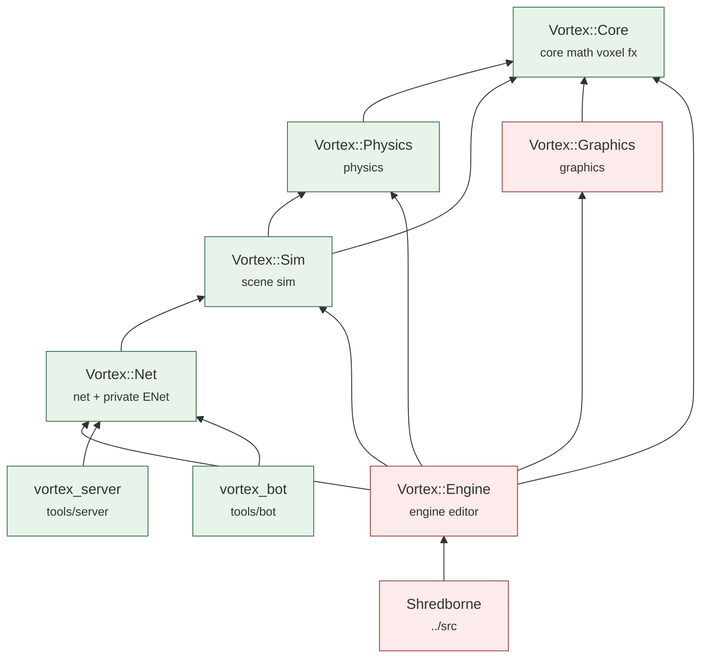
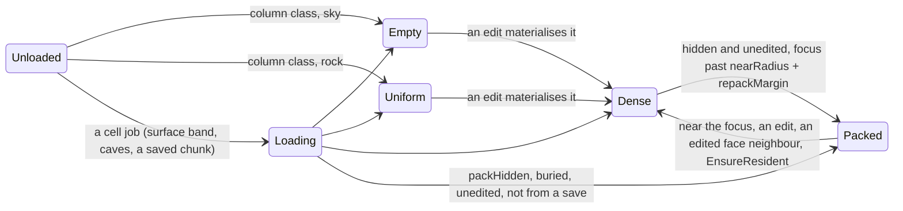

# VORTEX architecture

[[../../00 Docs Map|Docs map]] · [[README|docs index]] · [[ROADMAP|roadmap]] · [[design/networking|networking]] · [[design/shred|shred]] · [[design/view-distance|view distance]] · [[design/lod|LOD]] · [[design/fx-budget|fx budget]] · [[design/perf|perf]] · [[design/game-ui|game UI]] · [[design/worldgen|worldgen]] · [[design/collapse|collapse]] · [[design/fog|fog]] · [[design/mechanisms|mechanisms]] · [[design/spread|spread]] · [[design/rendezvous|rendezvous]] · [[notes/voxel|voxel notes]] · [[notes/net|net notes]] · [[notes/graphics|graphics notes]] · [[notes/physics|physics notes]] · [[notes/scene-engine|scene/engine notes]] · [[notes/core-fx-editor|core/fx/editor notes]]

VORTEX is a voxel engine for large, fully editable worlds rendered by ray marching, in the
spirit of Teardown's renderer, with the scale and freedom of a Minecraft-like world. Its game,
Shredborne, is a session PvP prototype on a destructible world, with an offline sandbox and an
editor. This document is the reference for how the engine is put together and the contracts its
parts share: it says how and why. What was decided, and when, is in the design documents; each
module's traps are in `notes/`. The index of every document is [README.md](README.md). If code and
document disagree, fix one of them.

## 1. Goals and non-goals

| Goal | Consequence in the design |
|---|---|
| Huge, streaming world | Sparse chunk storage, a toroidal window that moves with the player, generation on worker threads. Persistence (region files that store only what players changed) is a feature of `voxel::World` used by the offline game and the map editor. A session's world is a region that resets every session: template + seed, memory only (7.4, 7.5). |
| Everything destructible | Voxels are the single source of truth for rendering, collision and gameplay queries; edits are local and cheap (one 37 KiB chunk re-upload). Terrain that loses its support, or hangs on too weak a neck, falls (7.2). |
| Sessions over the network | One server decides; terrain changes are integer-exact operations, the simulation runs on a numbered fixed tick, a player moves by one rule on every side, and the server builds without a GPU or a window (2, 7.4, 7.5). |
| Teardown-style image | Geometry is ray marched (no meshing); lighting is ray traced through the same data (soft sun shadows, ambient occlusion, emissive voxels) and accumulated over time. |
| Runs on integrated GPUs | Rendering at a fraction of the output resolution, one ray of each kind per pixel per frame, every feature can be switched off. |
| Testable without a GPU | Everything except `graphics` builds and runs headless; the ray traversal is one source file compiled for both the GPU and the CPU, so unit tests cover the shader logic. |

Not goals (yet): level of detail cascades for very long view distances, transparency /
refraction, fluid simulation (water is a shaded surface, 5.7), skeletal animation, audio, and a
persistent shared world (a session region resets; an on-demand server world for larger zones is
networking stage 9 `[net-9]`). Section 10 lists what the design already does to keep those doors
open.

## 2. Layout and layering

```
engine/
  cmake/                 Dependencies.cmake (pinned), VortexShaders.cmake (GLSL -> SPIR-V at build time)
  shaders/
    shared/              code compiled by BOTH glslang and the C++ compiler (trace, shading, cube)
    include/             GPU-only includes; common.glsl is the C++ <-> GLSL contract
    *.vert *.frag        one SPIR-V module each
  src/
    core/     vortex.core      log, jobs, profiler, input state, paths, rng, args, game HUD
                               (canvas, bitmap font, menu, cursor capture: data only)
    math/     vortex.math      AABB / frustum / transform, reverse-Z projection, simplex noise
    voxel/    vortex.voxel     chunks, chunk store, world streaming, generator, regions, models,
                               ray queries, colliders, connectivity, the cell graph and the load
                               check (:structure), chunk and world hashes (:hash), .vox / glTF import
    fx/       vortex.fx        particle simulation and effect presets
    physics/  vortex.physics   Jolt behind an engine interface, terrain collider streaming
    scene/    vortex.scene     entities (EnTT): components, object lifetime, destruction
    sim/      vortex.sim       the simulation: world + physics + terrain colliders + scene on a numbered tick;
                               world operations, blasts, regions and their templates, the player step,
                               NetIds and the piece budgets of a session server (replication)
    net/      vortex.net       the session protocol: transports (loopback, impaired, ENet / UDP, and the
                               UDP relay net::UdpRelay in :enet), wire format, messages, server, client,
                               chunk sync and the checks, the client clock and prediction, replicated
                               bodies (copies, snapshots, the entity check), bot pilots, and the shared
                               bot (:bot: net::Bot, DrainWatch, JudgeBot, the exit lines)
    graphics/ vortex.graphics  Vulkan device, window, renderer, UI layer
    engine/   vortex.engine    application loop, render data of the scene, explosions, glue
    editor/   vortex.editor    in-game editor: tool logic (no ImGui), panels, gizmo
  tests/                 GoogleTest suites (section 9), none of which need a GPU
  tools/                 server/: vortex_server (the session server, GPU-free) and example session files;
                         bot/: vortex_bot (one bot player in its own process over UDP, GPU-free; the soak)
```

Libraries and what they may depend on (a lower layer never imports a higher one):

```
Vortex::Core      core, math, voxel, fx        -> spdlog, glm, tinygltf      (no GPU, no window)
Vortex::Physics   physics                      -> Core, Jolt
Vortex::Sim       scene, sim                   -> Core, Physics, EnTT        (no GPU, no window)
Vortex::Net       net                          -> Sim; ENet (private)        (no GPU, no window)
Vortex::Graphics  graphics                     -> Core, Vulkan, VMA, vk-bootstrap, GLFW, ImGui
Vortex::Engine    engine, editor               -> all of the above, ImGuizmo
vortex_server     tools/server                 -> Net                        (no GPU, no window)
vortex_bot        tools/bot                    -> Net                        (no GPU, no window)
Shredborne (game) ../src                       -> Engine (and so Net and ENet)
```



The green set is GPU-free: `vortex_assert_gpu_free` checks all of it (with `vortex_enet` and the test binaries named
below) for Vulkan, GLFW, vk-bootstrap, VMA, ImGui and ImGuizmo. `Vortex::Graphics` and `Vortex::Engine` (red) are the
only libraries that ever see a device; the game links Engine.

The graph is not a single chain. The simulation side is `Core <- Physics <- Sim <- Net`. The
renderer stands beside it: `Vortex::Graphics` depends on `Core` only (it imports core, math, voxel
and fx) and knows nothing of physics, the scene, the simulation or the network. `Vortex::Engine`
links all five. It imports everything but `vortex.net`: the engine draws a `sim::Simulation`
whoever feeds it, and the game's session code (`src/Session.cpp`) is what imports `vortex.net`.

A dedicated server or a tool links `Vortex::Net` (or less) and never sees Vulkan. Two checks run
when the build is configured (`CMakeLists.txt`; both walk everything a target links, directly or
through its dependencies, PRIVATE links of static libraries included):

* `vortex_assert_gpu_free` stops with an error if Graphics, Engine, Vulkan, GLFW, vk-bootstrap,
  VMA, ImGui or ImGuizmo is in the closure of `VortexCore`, `VortexPhysics`, `VortexSim`,
  `VortexNet`, `vortex_enet` (ENet built from source), the test binaries `VortexSimTests` and
  `VortexNetTests`, or the executables `vortex_server` and `vortex_bot`.
* `vortex_assert_no_network` stops it if `VortexNet` or ENet is in the closure of `VortexCore`,
  `VortexPhysics`, `VortexSim` or `VortexSimTests`. ENet is linked privately into `Vortex::Net`
  and reaches only what links that (the server, the bot, `VortexNetTests`, the engine and the
  game); only `src/net/internal/Enet.cpp` includes `<enet/enet.h>`.

What the checks do not see:

* **Order inside one library.** A library is all of its directories in one target, so the
  direction between its modules is kept by review only: in Core, `core <- math <- voxel` and
  `core <- fx`; in Sim, `scene <- sim`; in Engine, `engine <- editor`. An import cycle fails to
  build; an import in the wrong direction without a cycle does not.
* **The renderer's side.** Nothing walks `Vortex::Graphics` for Physics, Sim or Net: that it
  depends on Core only is kept by review.
* **Imports and includes.** The checks read link targets, not what a module imports or includes.
* **The Core and Physics test binaries** are not walked; each links one GPU-free library.

Inside `Vortex::Sim`, `scene` is the lower layer: it imports voxel, fx and physics, nothing of
graphics and not `vortex.sim`. `sim` owns the scene together with the world, physics and the
terrain colliders (`sim::Simulation`, 7.4). In `Vortex::Engine`, `engine` owns one
`sim::Simulation`, steps it and draws it; the two functions that turn a scene into render data
(`GatherInstances`, `GatherLights`) live there because their result types are graphics types.
`editor` is the top layer: it imports `vortex.engine`, and nothing in `engine` or below knows it
exists - a game that wants the editor owns an `editor::Editor` and forwards two callbacks to it
(section 8).

Module partitions worth knowing by name: `vortex.voxel:structure` (`Structure.cppm`: the cell
graph, its cache and the load check, 7.2), `vortex.voxel:hash` (`Hash.cppm`: `voxel::ChunkHash`,
`voxel::WorldHash`, the generator's golden hash and `voxel::MaterialTableHash`, which sessions
compare, 7.5) and `vortex.net:bot` (`Bot.cppm`: one bot player and the shared exit lines, used by
`vortex_server`'s in-process bots, `vortex_bot` and the game's headless session exit).

## 3. Conventions

* **C++20 named modules**, Clang. One module per directory (`vortex.<dir>`), one partition per
  `.cppm` file, re-exported by the primary interface (`Voxel.cppm` ...). Implementation units
  (`internal/*.cpp`) start with `module vortex.<dir>;`.
  * All `#include`s go in the global module fragment (between `module;` and the module
    declaration), standard and third-party headers alike. Names from headers included by an
    imported module are **not** visible to the importer: include what you use.
  * Interfaces are contracts: implementation work must not change exported signatures.
* **Naming**: `PascalCase` types and functions, `m_PascalCase` private members, `camelCase`
  public fields and locals, `kPascalCase` constants. Namespaces `vortex`, `vortex::math`,
  `vortex::voxel`, `vortex::fx`, `vortex::physics`, `vortex::graphics`, `vortex::scene`, `vortex::sim`,
  `vortex::net`, `vortex::editor`.
* **Errors**: no exceptions across engine APIs. Functions that can fail return `bool` /
  `optional` / an invalid handle and log the reason (`Log::Error("... {}", x)`, std::format
  syntax). `Verify(cond, msg)` is for invariants whose violation would corrupt memory.
  Running out of a fixed budget (chunk slots, particles, GPU buffer space) must degrade
  gracefully - drop, log once - and never write out of bounds.
* **Threading**: public interfaces are main-thread only unless documented otherwise. Worker
  jobs (`JobSystem`) get their inputs by value and hand results back through a queue owned by
  the system that submitted them.
* **Units and axes**: metres, seconds, kilograms, radians. Right-handed, +Y up, the camera
  looks down -Z at yaw 0. Colours are linear RGB everywhere except in files and the final
  output transform.
* **Warnings**: engine code compiles clean with `-Wall -Wextra -Wpedantic`.

## 4. Voxel data

### 4.1 Chunk (36 936 bytes, identical on CPU and GPU)

A chunk is 32^3 voxels. `voxel::Chunk` = occupancy pyramid + one byte per voxel:

```
ChunkOccupancy  (4168 bytes = 1042 uint32, uploaded verbatim)
  word 0..1     cellMask   64 bits   8^3 cells   bit = cx + cy*4 + cz*16      (cx = x >> 3)
  word 2..17    blockMask  512 bits  4^3 blocks  bit = bx + by*8 + bz*64      (bx = x >> 2)
  word 18..1041 voxelMask  512 x 64  voxels      word 18 + block*2 + (bit >> 5), bit = lx + ly*4 + lz*16 (lx = x & 3)
ids[32768]      material id per voxel, block-ordered: index = block * 64 + bit
```

`Chunk::Set` maintains all three levels in both directions (removing the last voxel of a
block clears its bits). A ray walks only the pyramid and reads `ids` once, at the hit.

Voxel id 0 is empty. Ids 1..255 index the *palette* of whatever the chunk belongs to
(`MaterialLibrary`: palette 0 is the world palette, each imported model can bring its own).
On the GPU all palettes form one array: material index = `palette * 256 + id`.

### 4.2 Chunk store

`voxel::ChunkStore` is a pool of chunks addressed by **slot**. The slot is the identity of a
chunk everywhere: the world grid stores slots, objects reference slots, the CPU tracer resolves
slots and the renderer mirrors slot `i` at offset `i` of its GPU buffers. Anything that changes
a chunk calls `MarkDirty(slot)`; the renderer drains `TakeDirty()` once per frame.

### 4.3 World

`voxel::World` keeps a box of chunks around a focus point - the *window*, `windowSize` chunks. Each window cell is
`Unloaded`, `Loading`, `Empty`, `Uniform` (one solid material, no storage), `Dense` (owns a slot) or `Packed` (dense
content no ray can reach: only its RLE bytes on the CPU, no slot). Cells are stored in a toroidal array
(`index = coord mod size`, **column-major**: `(x + z*sx) * sy + y`), so moving the window re-targets one slab of
columns, each a contiguous run, and moves no data.



A carved-out chunk stays `Dense` and keeps its slot. Not drawn: every cell returns to `Unloaded` when the window
leaves it, and a session's `World::SetChunkEncoded` (chunk sync, 7.5) installs any kind over any cell, releasing a slot
it no longer needs. Packing and unpacking are never a content change (**Packed** below): the same voxels hash alike in
`Dense` and `Packed`.

**Full-height window** (`WorldConfig::fullHeight`, the game's setting; `docs/design/view-distance.md`, stage 1).
The window covers a fixed range of rows - `heightRange`, or the generator's `IWorldGenerator::VerticalBounds()` plus
`buildHeadroom` (32 m), rounded outwards to `heightSnap` (16 m): -48..128 m = 44 rows at the default 0.125 m (55 at 0.1 m) for the built-in
terrain - and follows the focus in x and z only, so climbing or flying never unloads anything. The top of the range
is the **build ceiling** (`World::BuildCeiling()`): an edit that would write a solid voxel above it is refused whole
(`EditReport::outOfBounds`, decided from integers), `Scene::CreateVoxelObject` refuses a model reaching above it, and
`Scene::DestroyAbove` is the kill plane for bodies thrown over it (the terrain guard treats the sky above the window
as ready). A session's world is full height over its region's range (`sim::RegionWorldConfig`, 7.5). Without known
bounds (or with `fullHeight` off: some tests) the window is centred on its focus in all three axes.

**Column pass.** Every column of the window first gets one job: `IWorldGenerator::ClassifyColumn(cx, cz)` (from the
height tile the terrain generator builds anyway) says which rows are certainly Empty (`>= emptyFrom`), certainly
Uniform (`< solidBelow`) and where the surface band starts (`surfaceFrom`); `Generate` makes its own early-outs from
the same function, so the two agree (tested). Sky and rock cells are installed without a job unless the
`RegionStore` holds a saved chunk there; band cells become `VX_GRID_PENDING` until generated. Jobs go out by
horizontal distance (a counting sort of the columns, rebuilt per window move): everything within `nearRadius`
(16 m) of the focus first, then classification and the surface band of every column, then the buried (cave) rows
(`surfaceFirstBacklog`, default 0 = all surfaces first). The integration budget counts Dense results only.

**Packed** (`WorldConfig::packHidden`, needs the column pass). A Dense result farther than `nearRadius` + half a
chunk from the focus whose row lies below the lowest surface voxel of every column of its 3 x 3 neighbourhood, that
is not from a save and has no face neighbour that is edited or from a save, keeps its `EncodeChunk` runs and shows
in the grid as `0x80000000 | most frequent id`. Columns outside the window are not known when a chunk at the edge is
judged: when a column is classified, the Packed chunks of its neighbours are judged again and the visible ones
decoded. A Packed chunk is made resident (decoded into a slot) when the focus comes within `nearRadius` (scanned
whenever the focus moved a quarter chunk), when an edit touches it (decoded at its first changed voxel, exactly like
an Empty / Uniform cell), for the six face neighbours of every chunk an edit changed or a saved chunk that loads, and
by `EnsureResident`. A resident chunk that is unedited and hidden keeps its runs and is packed again once the focus is
`repackMargin` (8 m) beyond `nearRadius` (so a session in one area does not fill the store). Packing and unpacking
are not content changes: `TakeChangedChunks` does not list them, `WorldHash` hashes the runs, `GetVoxel` /
`ReadChunk` read them, saves are unchanged. `GetChunk` returns nullptr for a Packed chunk (readers that need its
voxels use `ReadChunk`: physics, island search). A load result that finds the store full is kept Packed (drawn as
rock), never installed as Empty, so a saved chunk is never lost (`WorldStats::storeFullLoads`).

`World::Grid()` is the cell array in GPU encoding: `0` empty, `0x80000000 | id` uniform (or packed), `0x80000000`
(id 0) pending, `slot + 1` dense. `World::GridWords()` - what is uploaded - appends one **column top** per column
(window rows `>=` it are air in that column), the **content top** (their maximum) and one **region top** per 4 x 4
columns of the window (window-relative). Raised tops are written at once, lowered ones lazily (a top that is too
high only costs steps). `GridPageRevisions()` gives the revision at which each 4 KiB page last changed; the renderer
copies only those.

Loading runs on the job system (`RegionStore` first, generator second); results are installed on the main thread.
Cells and columns carry generation counters so results for a chunk or column that has left the window are dropped.

Editing (`SetVoxel`, `FillBox`, `FillSphere`, `CarveSphere` and the quantised `FillSphereQ`,
`CarveSphereQ`, `SwapSphereQ`, `ClearMask`) materialises Empty / Uniform cells on demand, marks
slots dirty, flags the cell as modified (it will be saved when it leaves the window or on
`Save()`), and records the chunk in `TakeChangedChunks()` for physics. Every edit goes through
one private routine, `World::EditRegion` (a box, a per-voxel decision, the fixed visit order below).

**Chunk revision.** `World::ChunkRevision(chunk)` is a number that changes whenever the content of a
loaded chunk may have changed: an edit (wherever `EditRegion` queues a change: game, editor, `FillBox`,
replicated operations), `SetChunkEncoded`, a load or an unload. It is 0 for a chunk that is not loaded
and never reused within one `World`; packing and unpacking keep it. Data derived from a chunk is cached
under it: the cell graphs of the island search (`voxel::TerrainGraphCache`, 7.2) and a session server's
chunk hashes (7.5). A new edit path that changed voxels without going through `EditRegion` (or bumping
the revision) would leave those caches stale.

**Replicated edits are integer-exact** (`docs/design/networking.md`, "World operations"). A
`voxel::SphereQ` has its centre and radius in q = 1/16 voxel; a voxel is inside when
`d = 16 v + 8 - centre` gives `dot(d, d) <= radius^2` in int64. Carve power is in 1/16 hardness
units and compared as `hardness * 16 > power` (exact). The float `FillSphere` / `CarveSphere`
quantise (`QuantizeSphere`, `QuantizePower`: round to nearest, halves away from zero) and forward,
so every sphere edit is the same integer operation. Every edit visits chunks in (y, z, x) and
voxels in (z, y, x) order and decides from (voxel, old id) only. Given a `voxel::EditReport` it lists
the chunks it touches but could not change: `skipped` (outside the window, Unloaded, Loading) and
`unsynced` (Empty / Uniform with no free store slot); a chunk is changed completely or not at all.
`sim::WorldOp` / `sim::ApplyOp` (7.4) wrap these calls as the unit that travels.

**Render space.** World positions are `double`. Everything a ray or the GPU touches is
expressed relative to `World::WindowOrigin()` (the window's minimum corner): *render space*.
Coordinates therefore stay below a few hundred metres and keep full float precision anywhere
in the world. When the window moves, the origin jumps by whole chunks; the renderer
re-expresses last frame's matrices in the new space.

### 4.4 Objects

A dynamic object is a `voxel::VoxelModel`: a dense `VoxelVolume` of any size plus the chunks
it was *baked* into (`ModelPart`: slot, offset, tight bounds). Models are shared between
entities; a model is never modified through an entity - destruction gives the damaged entity a
private new model (section 7). The chunk slots of a model go back to the store with its last
reference. Baking is all or nothing: if the store runs out of slots the model is left unbaked
and holds none. `Revision()` changes on every bake so dependants (physics shapes) know when to refresh.

For rendering and ray queries each part becomes a `GpuInstance` (transform + slot + bounds +
palette); a BVH over the instances (`BuildBvh`, rebuilt per frame) lets rays find them.

### 4.5 The shared traversal

`shaders/shared/trace.glsl` is written in the subset of GLSL that is also valid C++ (see
`shared/vx_cpp.h` for the rules). glslang compiles it into the shaders; the C++ compiler
compiles the same text as member functions of `voxel`'s `TraceKernel`, which backs
`voxel::Trace`, `World::Raycast` and the unit tests. One implementation, verified on the CPU
against a reference DDA, runs on the GPU.

* `VxTraceChunk` - hierarchical walk of one chunk: empty 8^3 cells and 4^3 blocks are left in
  one step. Exit positions are computed from the plane crossed (no accumulation, no epsilons).
* `VxTraceWorld` - DDA over the chunk grid in window-local voxel units; uniform chunks are hit
  as boxes, dense chunks descend into `VxTraceChunk`. A cell at or above its column's top is left
  through the column's air prism in one step - or the whole 4 x 4 region's prism when it is above the
  region top - out through x / z or down onto the top; a rising ray above the content top ends. A
  pending cell stops the ray with material 0 (the G-buffer writes it as sky with a depth; `World::Raycast`
  reports no hit). Tested against the traversal without the tables and a voxel DDA on 48 x 55 x 48.
* `VxTraceInstances` - stack-based BVH traversal, then `VxTraceChunk` in each instance's
  local space. The local direction is not renormalised, so `t` stays comparable across objects.
* `VxTraceScene` - world + instances, closest or any hit. Inputs in render space, metres.

## 5. Rendering

Vulkan 1.3 with dynamic rendering and synchronization2. All passes are full-screen or
instanced draws with **one descriptor set (set 0)** whose layout is reflected from SPIR-V;
resources are bound by name (`DescriptorWriter`). `shaders/include/common.glsl` defines the
per-frame uniform block, every buffer binding and the G-buffer encoding; `graphics::FrameUniforms`
mirrors the block. Unit tests compare the two through reflection.

### 5.1 Conventions

* **Depth** is reversed with an infinite far plane (`math::PerspectiveReverseZ`): 1 at the
  near plane, 0 at infinity; the depth buffer is cleared to 0 and tested with `GREATER`.
  Ray marched fragments write `gl_FragDepth = near / (t * dot(rd, forward))`.
* **Jitter** (TAA) is added in clip space: `proj[2][0] = -jitter.x`, `proj[2][1] = -jitter.y`
  (jitter in NDC units, a Halton(2,3) offset of +-0.5 pixel = `(h - 0.5) * 2 / resolution`).
  `VxCameraRay(uv)` subtracts the same jitter, so ray marched and rasterised geometry agree.
* **Facing.** Vulkan decides facing from the on-screen winding, and the projection keeps the
  image upright, so geometry that is counter-clockwise seen from outside uses
  `VK_FRONT_FACE_COUNTER_CLOCKWISE`. `shared/cube.glsl` provides the proxy cube
  (`VxCubeCorner`), and a unit test checks its winding against the projection.
* **Colour**: lighting in linear HDR (`R16G16B16A16_SFLOAT`); the present pass applies
  exposure, tone mapping and the sRGB curve into a UNORM backbuffer (which is also what ImGui
  expects).

### 5.2 Buffers (set 0)

| binding | name | contents | written |
|---|---|---|---|
| 0 | `u_Frame` | `FrameUniforms` (UBO) | every frame |
| 1 | `u_Grid` | `World::GridWords()`: cells, column tops, content top, region tops (`uint[]`) | the 4 KiB pages whose revision changed, and the page of a cell whose slot was just uploaded |
| 2 | `u_Occ` | occupancy pyramids, 1042 words per slot | dirty slots |
| 3 | `u_Ids` | voxel ids, 8192 words per slot | dirty slots |
| 4 | `u_Materials` | `VxMaterial[]`, 256 per palette (`params.w` = surface kind: 0 solid, 1 liquid) | when `MaterialLibrary::Revision()` changes |
| 5 | `u_Instances` | `VxInstance[]` | every frame |
| 6 | `u_Bvh` | `VxBvhNode[]` | every frame |
| 7 | `u_DrawList` | instance indices to rasterise: front-facing boxes first, then boxes containing the camera | every frame |
| 8 | `u_Lights` | `VxLight[]` | every frame |
| 9 | `u_Particles` | `VxParticle[]` | every frame |
| 10 | `u_Hud` | `VxHudQuad[]` (= `vortex::HudQuad`, 32 bytes: rect in output pixels, RGBA8 colour, 45 cell bits) | every frame |
| 16+ | per-pass textures | declared by each shader | |

`u_Occ`, `u_Ids`, `u_Grid`, `u_Materials` are device-local and filled through a per-frame
staging buffer with `vkCmdCopyBuffer` at the start of the frame's command buffer (never
written while a frame in flight reads them). Chunk uploads are budgeted per frame
(`RenderSettings::maxChunkUploadsPerFrame`); the GPU copy of the grid only exposes a dense
chunk once its data has been uploaded (until then the entry is written as empty), so the GPU
never traverses a slot it has not received. Per-frame data (uniforms, instances, BVH, draw
list, lights, particles, HUD quads) lives in host-visible buffers owned by each frame-in-flight; they grow
(power of two) when needed and the old buffer goes to that frame's deletion queue. An
always-bound buffer is never zero-sized: empty arrays still bind a small valid buffer.

### 5.3 Render targets (R = render resolution = output * renderScale, O = output)

| target | format | size | content |
|---|---|---|---|
| gMaterial | `R32_UINT` | R | bits 0..23 global material index, 24..31 per-voxel variation; 0 = sky |
| gNormal[2] | `A2B10G10R10_UNORM_PACK32` | R | world normal * 0.5 + 0.5 (ping-pong: current / previous frame) |
| gVelocity | `R16G16_SFLOAT` | R | uv(current) - uv(previous) |
| depth[2] | `D32_SFLOAT` | R | reverse-Z, 0 = sky (ping-pong) |
| lighting[2] | `R16G16B16A16_SFLOAT` | R | rgb = accumulated diffuse irradiance, a = accumulated sun specular amount (liquids: accumulated sun visibility) |
| lightCount[2] | `R8_UNORM` | R | accumulated frame count / 255 |
| hdr | `R16G16B16A16_SFLOAT` | R | lit scene + particles |
| taa[2] | `R16G16B16A16_SFLOAT` | R | resolved history |
| backbuffer | swapchain image, or `R8G8B8A8_UNORM` offscreen when headless | O | |

### 5.4 Passes

Every pass that samples a target transitions it to `SHADER_READ_ONLY_OPTIMAL` first and every
pass that renders to one transitions it to its attachment layout (`TransitionImage` tracks the
current layout per image). All full-screen passes use `fullscreen.vert` (3 vertices, no buffers).

1. **gbuffer** - attachments gMaterial, gNormal[cur], gVelocity, depth[cur]; all cleared (depth 0).
   * `gbuffer_world.frag` (full-screen, depth test GREATER + write): marches
     `VxTraceWorld(u_Frame.cameraPosVoxel.xyz, VxCameraRay(uv), 0, big)`; a miss discards.
     Writes the packed material (world palette = 0, variation = `VxVoxelHash` of the absolute
     voxel), normal, motion vector (static world: previous position = current position) and
     `gl_FragDepth`.
   * `gbuffer_object.vert` + `gbuffer_object_front.frag` (instanced, 36 vertices, cull BACK):
     one proxy box per instance = its tight voxel bounds. The fragment shader takes the pixel's
     own view ray (`VxCameraRay`), transforms it into chunk-local space, clips it against the
     bounds and runs `VxTraceChunk`. `layout(depth_less)` lets early-Z reject hidden boxes.
     Motion vector uses `prevLocalToWorld`. Draws instances `[0, frontCount)` of the draw list.
   * `gbuffer_object_inside.frag` (same source, cull FRONT, no depth qualifier): for the few
     boxes that contain the camera or straddle the near plane. Draws `[frontCount, frontCount + insideCount)`.
   * With debug view `VX_DEBUG_STEPS` both write material `VX_GBUFFER_DEBUG` and a heat colour
     of the step count into the normal target.
2. **lighting** - attachments lighting[cur], lightCount[cur]. Per pixel with geometry: one
   jittered sun shadow ray (`VxTraceScene`, any hit), one cosine-weighted ambient ray of length
   `ambientParams.y` (miss -> sky radiance of that direction; hit an emissive voxel -> its
   emission, which is how glowing voxels light their surroundings), all point lights in range
   with a single stochastically chosen shadow ray, and a sun specular term. The result is
   blended with the reprojected history (lighting[prev], validated against depth[prev] and
   gNormal[prev]) with weight `1 / min(count + 1, maxHistory)`.
3. **composite** - attachment hdr. Sky for empty pixels; otherwise albedo (material colour
   with per-voxel variation) x filtered lighting + emission + specular, then the effect lights,
   then height fog. Effect lights (blast flashes, `PointLight::effect`) are not traced in the
   lighting pass: the renderer merges them on the CPU into at most 8 (`fx::MergeEffectLights`)
   and puts two `u_Lights` records per light after the shadowed ones (A: position and radius,
   radiance; B: the clip box min and max, render space). `FrameUniforms::effectLights` holds the
   count (x) and the first record (y = `counts.z`). Composite adds each one unshadowed, without
   history, only inside its axis clip box (from 6 `World::Raycast` calls at spawn, so a wall
   between the flash and a surface stops it along the axes).
   The lighting is filtered with a small depth / normal aware kernel that widens while the
   history is short. Liquids are shaded here as an animated surface (5.7). Debug views are
   produced here.
4. **particles** - attachment hdr (load), depth[cur] as read-only test (no write). Instanced
   camera-facing quads from `u_Particles`, premultiplied blending (additive particles have
   opacity 0). The CPU sorts the blended particles back to front and appends the additive ones
   unsorted in pool order. The fragment shader reads the shape from a flat varying, not from
   `u_Particles`.
5. **taa** - attachment taa[cur]. Reprojects taa[prev] with the motion vector of the closest
   depth in a 3x3 neighbourhood, clamps it to the neighbourhood colour box, blends with weight
   `temporalParams.y`. Pass-through when TAA is off or the history is invalid.
6. **present** - attachment backbuffer (O). Bilinear upscale, exposure, tone mapping, sRGB
   curve, the HUD backdrop dim (`settings.w`, section 11), dither; then in the same rendering
   scope:
7. **hud** - the game interface (section 11): `hud.vert` / `hud.frag`, one instanced draw
   `vkCmdDraw(6, quadCount, 0, 0)` of `u_Hud`, premultiplied blending, display-space colours, no
   texture: each quad is a 5 x 9 cell grid and a cell is drawn when its bit is set (solid
   rectangles have all 45 bits, glyphs their bitmap). Works headless (it is in screenshots).
8. **imgui** - `UiLayer::Draw` (debug overlay and editor; records nothing when no window was
   submitted).

Passes 6..8 are three timestamp intervals inside one rendering scope.

After the frame the `cur` / `prev` indices swap. History is invalidated (`temporalParams.z = 0`)
on the first frame, after a resize and after a camera cut.

### 5.5 Frame

```
RenderFrame(input)
  resize / minimise handling, wait for this frame slot's fence, flush its deletion queue
  acquire swapchain image (windowed); out-of-date -> recreate and skip the frame
  begin command buffer, reset this slot's descriptor pool
  sync voxel data: staged copies for dirty slots (budgeted), grid, materials
  build frame data in render space: uniforms, instances (+ frustum culling into the draw list,
    front / inside classification), BVH, lights, particles
  passes 1..8 with GPU timestamps (6..8 share the backbuffer rendering scope)
  screenshot copy if requested
  submit, present (windowed); out-of-date -> recreate
```

Two frames in flight. Each owns: command pool + buffer, fence, image-acquired semaphore,
descriptor pool (reset each use), its dynamic buffers, a staging buffer, a timestamp query
pool and a deletion queue. Render-finished semaphores are per swapchain image.

Headless mode has no swapchain: the backbuffer is an offscreen image and "present" is a no-op;
`RequestScreenshot` writes it as PNG. This is how the renderer is exercised on CI.

### 5.6 Shader interface (the exact contract between `Renderer` and the shader files)

Pipelines, their shader files (compiled to `assets/shaders/<file>.spv`), state and resources.
Buffers are the blocks declared in `common.glsl`; textures are declared by the shader itself
with exactly these names, bindings and types. `nearest` / `linear` name the sampler the
renderer binds (both clamp-to-edge); G-buffer inputs are read with `texelFetch`.

| pipeline | vertex / fragment | colour attachments | depth | cull, front face | blend |
|---|---|---|---|---|---|
| gbuffer_world | `fullscreen.vert` / `gbuffer_world.frag` | R32_UINT, A2B10G10R10, R16G16_SFLOAT | D32, test GREATER, write | none | opaque |
| gbuffer_object_front | `gbuffer_object.vert` / `gbuffer_object_front.frag` | same | D32, test GREATER, write | BACK, CCW | opaque |
| gbuffer_object_inside | `gbuffer_object.vert` / `gbuffer_object_inside.frag` | same | D32, test GREATER, write | FRONT, CCW | opaque |
| lighting | `fullscreen.vert` / `lighting.frag` | RGBA16F, R8_UNORM | - | none | opaque |
| composite | `fullscreen.vert` / `composite.frag` | RGBA16F | - | none | opaque |
| particles | `particles.vert` / `particles.frag` | RGBA16F | D32, test GREATER, no write | none | premultiplied |
| taa | `fullscreen.vert` / `taa.frag` | RGBA16F | - | none | opaque |
| present | `fullscreen.vert` / `present.frag` | backbuffer format | - | none | opaque |
| hud | `hud.vert` / `hud.frag` | backbuffer format | - | none | premultiplied |

Draw calls: full-screen passes `vkCmdDraw(3, 1, 0, 0)`; object boxes `vkCmdDraw(36, count, 0, firstInstance)`
where the vertex shader reads `u_DrawList.indices[gl_InstanceIndex]` (in Vulkan `gl_InstanceIndex`
includes `firstInstance`); particles `vkCmdDraw(6, particleCount, 0, 0)` (two triangles per
instance, corner derived from `gl_VertexIndex`); HUD `vkCmdDraw(6, quadCount, 0, 0)` the same way.

`fullscreen.vert` outputs `layout(location = 0) out vec2 v_Uv` with (0,0) at the top-left.

Resources per shader (set 0):

| shader | buffers | textures (binding: name, type, sampler) |
|---|---|---|
| `gbuffer_world.frag` | `u_Frame`, `u_Grid`, `u_Occ`, `u_Ids`, `u_Instances`, `u_Bvh` (via `VX_NEED_TRACE`) | - |
| `gbuffer_object.vert` | `u_Frame`, `u_Instances`, `u_DrawList` | - |
| `gbuffer_object_*.frag` | `u_Frame`, `u_Grid`, `u_Occ`, `u_Ids`, `u_Instances`, `u_Bvh` | - |
| `lighting.frag` | `u_Frame`, trace buffers, `u_Materials`, `u_Lights` | 16 `u_GMaterial` usampler2D nearest; 17 `u_GNormal` sampler2D nearest; 18 `u_GDepth` sampler2D nearest; 19 `u_GVelocity` sampler2D nearest; 20 `u_PrevLighting` sampler2D linear; 21 `u_PrevLightCount` sampler2D linear; 22 `u_PrevDepth` sampler2D nearest; 23 `u_PrevNormal` sampler2D nearest |
| `composite.frag` | `u_Frame`, `u_Materials`, `u_Lights` (effect lights only) | 16 `u_GMaterial` usampler2D nearest; 17 `u_GNormal` sampler2D nearest; 18 `u_GDepth` sampler2D nearest; 19 `u_Lighting` sampler2D nearest; 20 `u_LightCount` sampler2D nearest |
| `particles.vert` / `.frag` | `u_Frame`, `u_Particles` | - |
| `taa.frag` | `u_Frame` | 16 `u_Color` sampler2D nearest; 17 `u_History` sampler2D linear; 18 `u_GVelocity` sampler2D nearest; 19 `u_GDepth` sampler2D nearest |
| `present.frag` | `u_Frame` | 16 `u_Color` sampler2D linear |
| `hud.vert` / `.frag` | `u_Frame`, `u_Hud` | - |

A shader that includes the trace buffers but does not use all of them still declares them
(the reflected layout then contains them and the renderer binds them): the renderer binds
every binding a pipeline reflects, by name, and `DescriptorWriter` reports anything missing.
Depth targets are sampled as `sampler2D` (`.r`) while in `SHADER_READ_ONLY_OPTIMAL`; in the
particle pass the same image is the depth attachment in `DEPTH_READ_ONLY_OPTIMAL`.

G-buffer fragment outputs: `layout(location = 0) out uint o_Material; layout(location = 1) out vec4 o_Normal;
layout(location = 2) out vec2 o_Velocity;` plus `gl_FragDepth`. Lighting outputs:
`layout(location = 0) out vec4 o_Lighting; layout(location = 1) out float o_Count;`.

### 5.7 Liquids

There is no water simulation and no transparency: water and lava are ordinary opaque voxels
(`MaterialFlag_Liquid`), traced, lit and accumulated exactly like stone. `MaterialLibrary` packs
the flag into `GpuMaterial::params.w` (`kGpuMaterialLiquid` = `VX_MATERIAL_LIQUID`), and the
composite pass - which reads the material anyway - shades such pixels with `ShadeLiquid` instead
of the diffuse + specular sum. No extra pass, target, texture or uniform.

* **Animated normal.** On faces that look up, the flat G-buffer normal is replaced by the normal
  of a procedural height field (`WaterSlope`): one octave of value noise with an analytic gradient
  for the large, irregular swell, plus four directional sine ripples whose phase is bent by that
  noise so they never form a regular pattern. Everything drifts with `temporalParams.w` (time).
  It is evaluated in *world* space: render-space position + `(gridMinChunk.xz & 1023) * chunk
  size`. Render space jumps by whole chunks when the window moves and `gridMinChunk` jumps with
  it, so the sum stays put; the wrap keeps float precision (the pattern changes once, in one
  frame, per 1024 chunks travelled; time wraps once per hour the same way).
* **No shimmer.** Each octave fades out before its wavelength reaches the pixel's footprint on
  the surface (distance x pixel angle / sine of the grazing angle), so distant water is a calm
  mirror rather than sub-pixel noise for TAA to fight. The glint lobe has a minimum width for the
  same reason.
* **Colour.** `body x (1 - m) + sky(reflected) x m + sun glint x m`, `m` = Schlick Fresnel
  (F0 0.02) x smoothness^2. The reflection is the analytic sky (`VxSkyRadiance`, no ray);
  terrain and objects are not reflected. The body is `albedo x accumulated irradiance`, darker
  at grazing view angles and lighter looking down - the stand-in for depth, which an opaque
  liquid does not have - and slightly brighter on ripples tilted towards the sun.
* **Shadows and lights.** The lighting buffer's rgb is used as it is, so cast shadows, ambient
  occlusion, point lights and emissive voxels all reach the water through the body term. For
  liquid pixels the lighting pass stores the plain **sun visibility** in the alpha channel
  instead of the sun specular (which composite does not use for liquids): `sunVisible` gates the
  glint and takes a quarter of the reflection away in cast shadows. It comes from the shadow
  rays alone, so no torch, spell or explosion light can switch a sun glint on, and there is no
  division by a small sun term at sunrise. `skyVisible`, which scales the reflection (a pool in
  a cave reflects no sky), is the rest of the lighting - luminance minus the sun's share, which
  is exact because both were accumulated from the same rays - relative to what an open surface
  receives (`mix(horizon, zenith, 0.8) x intensity`, the cosine-weighted mean of the sky
  gradient). Known limit: point lights and emissive light are part of that rest, so enclosed
  water lit by a strong local light still shows a sky-coloured reflection at grazing angles;
  telling them apart needs a fifth lighting channel.
* **Temporal passes.** Depth, normal and motion vectors of a liquid pixel are those of the static
  flat surface, so the lighting history, the checkerboard and the spatial filter behave as on any
  other material; only the composite output moves. The waves are slow and low-contrast enough
  for the TAA neighbourhood clamp to follow them: with and without TAA the image matches.
* **Cost** (UHD 620, 768x432, median of 120 frames, composite pass): 1.16 ms -> 1.32 ms with
  water on more than half of the screen, 1.30 ms -> 1.42 ms with about 40 %; a view without
  liquids is unchanged (1.91 ms -> 1.90 ms looking at grass).
* **Keep it small.** The Intel compiler builds this pass 8 and 16 pixels wide and the 16-wide
  variant has no registers to spare. A first version (three noise octaves, debug views after the
  shading) pushed its register allocation into a fallback schedule and made *every* pixel of the
  screen 12 % slower, liquid or not. Hence the single noise octave, the debug views as an early
  exit, and `ShadeLiquid` reducing its inputs before evaluating the waves. Check with
  `MESA_SHADER_CACHE_DISABLE=true INTEL_DEBUG=fs`: the composite shader's `SIMD16` line must say
  `scheduled with mode top-down`.

Lava takes the same path; its roughness (0.6) leaves almost no reflection, its emission is added
on top.

## 6. Physics

`physics::PhysicsWorld` wraps Jolt: bodies are compounds of boxes (from `BuildColliderBoxes`,
densities from materials, so mass and inertia are real) or static triangle meshes. It is
stepped with a fixed time step by `sim::Simulation` (7.4), as often as the engine loop or a
server asks; after every step the scene copies body poses into the entities' transforms
(`Scene::SyncFromPhysics`).

Every body carries 64 bits of user data, returned by ray casts and contact events. Bodies of
scene entities store `scene::ToUserData(entity)` (a tag in the upper half, the entity id in the
lower), terrain colliders store 0, so `Scene::EntityFromUserData` can tell them apart.

`physics::TerrainColliders` streams static meshes for terrain chunks: it snapshots a chunk and
its neighbours' border voxels on the main thread, cooks the mesh (`BuildChunkCollisionMesh` +
Jolt mesh shape) on a worker thread and installs the body on the main thread. It consumes
`World::TakeChunkChanges()` (each changed chunk with the box of the voxels edited in it). A chunk gets a collider for one of two reasons:

* it is within `EngineConfig::colliderRadius` of a *focus point* (the camera: the ground the
  player and things at rest nearby stand on), dropped again at 1.5x that distance;
* a **body needs it**: every awake dynamic body requests the chunks its bounds touch, swept
  along its velocity (0.75 s ahead, at most two chunks). These are cooked first and kept for
  120 updates after the last request. There is no limit on the number of bodies and the camera
  plays no part, so debris thrown 50 m away lands on real ground.

An edited chunk keeps its old collider until the re-cooked one is installed (removal and
creation happen in the same call), so there is no frame without ground under a resting body.
Three rules make this hold under continuous editing (a held brush, a channelled spell):

* A finished mesh is installed whenever it is newer than what is installed, even if the chunk
  was edited again while it cooked; the newest state is queued behind it. A chunk edited every
  frame therefore has a collider that is one frame old, instead of never getting one.
* The mesh of a chunk depends on its neighbours only through the collidability of the touching
  voxel layers. Each entry remembers those bits: a neighbour edit that leaves them unchanged
  does not re-cook the chunk at all.
* Border faces covered by a solid neighbour are not meshed. If carving a neighbour *uncovers*
  such faces (a shaft dug through the bottom of the chunk above), the collider has a hole
  there, so the chunk is **not ready** (6.1) until its re-cook is installed: bodies touching it
  wait a few frames with their velocity kept rather than drop into solid rock.

A changed chunk that has no collider entry (far from the camera) wakes the bodies parked on it
(`ActivateInBox`), so they ask for colliders and fall if their support was blasted away. Such a
chunk, and a chunk whose entry is dropped before an edit was cooked, is remembered: its first
build wakes what is around it too, so a body parked over it never resumes asleep in the air
(shred.md stage 1d; each guard pass keeps only the chunks a frozen body lies on).

### 6.1 Bodies never simulate without terrain

Terrain collision is not always there: the chunk may be outside the world window, still
loading, its mesh still cooking, or its collider dropped because nothing needed it. A body
simulated in such a place falls through the world. `TerrainColliders::GuardBodies()` - run by
`Update()` and again by the engine right before every `PhysicsWorld::Step()` - therefore checks
every dynamic body (`PhysicsWorld::GetDynamicBodies`):

* The chunks touched by its bounds, grown by one voxel and by what it travels in 0.05 s, must
  all be *ready*: loaded, and either with their collider built or needing none (air, liquid,
  rock enclosed by rock). If one is not, the body is **frozen**; when all are, it is released.
* Nor may they hold, where the body is (bounds grown by one voxel), voxels edited since their
  installed collider was cooked: that collider still has the old voxels there. Each entry keeps
  the box of the edits not cooked yet (per snapshot generation, so a chunk edited every frame is
  stale only where the newest results do not reach). A piece that broke off is created exactly
  where its voxels were; it waits frozen, its push kept, for the re-cooked collider (shred.md
  stage 1d). `IsReady` does not apply this rule. `GuardBodies` first takes the chunk changes made
  since `Update()`, so an edit in a fixed update is seen before that step.
* `PhysicsWorld::SetFrozen` makes the Jolt body static (keeping its collision layer): it stays
  exactly where it is, nothing can wake it, other bodies rest on it. **The velocities are kept**
  and given back on release, so a body frozen in flight continues its flight - zeroing them
  would make thrown debris drop straight down whenever it outruns the cooking jobs. While
  frozen, `GetState` reports zero velocity, `active = false` and `frozen = true`.
* Wake-ups are deferred, not lost: `Activate`, `ActivateInBox`, `AddImpulse`, `SetVelocity` and
  `SetTransform(activate)` on a frozen body mark it as *wanting to move* (impulses and velocities
  change what it resumes with). A body that was awake when frozen wants to move from the start.
* A frozen body that wants to move keeps requesting its colliders, so it resumes within the few
  frames the cooking takes. One that was asleep - rubble the camera left behind - requests
  nothing: it is *parked*, costs one static body and no collider, and is released (still asleep)
  when a focus point brings the terrain back, or when something wakes it.
* At the edge of the world window a body simply stops: the chunk beyond is not loaded. It
  continues if the window moves over it. Nothing can leave the loaded world by falling. Above the
  top of a full-height window is sky over the build ceiling: ready, no collider, and the kill
  plane (`Scene::DestroyAbove`) removes what flies through it.
* A Packed chunk (4.3) needs a collider like a Dense one; its voxels come from `World::ReadChunk`.

Kinematic and static bodies are not guarded. Character controllers are not bodies: a player is
held by `sim::StepPlayer` while `TerrainColliders::HasCollider(capsule bounds)` is false - the
same chunks-touched-plus-one-voxel test as for bodies, but a chunk that has had its collider once
counts even while a neighbour's edit waits for its re-cook (`installed >= exposed`), because when
that re-cook lands differs between a server and its clients (networking.md "Player movement").
`Engine::TerrainReady(bounds)` / `IsReady` keep the full rule. (The point version only looks at
the chunk containing the point, which for feet standing on a chunk boundary is the empty chunk
*above* the ground.) What a character collides with is `PhysicsConfig::characterLayers`
(Static, Dynamic and Debris by default, never Character or Rubble; in a session `sim::kSessionCharacterLayers`, Static
and Dynamic, on the server and every client, with `PhysicsConfig::characterMovesBodies` off: a character neither pushes
nor weighs on a body, which is an obstacle and a floor to it). `Layer::Rubble` (networking stage 6) collides with
Static, Dynamic and itself, never with Debris or a character: a session client's own large rubble, its copies of server
bodies while they move, and a server's bodies while they move are in it, so nothing that moves differently on the two
sides blocks a player; at rest a replicated body is in `Layer::Dynamic` on both sides (`PhysicsWorld::SetLayer`).
`Layer::Bounds` holds the walls of `PhysicsWorld::SetCharacterWalls` (a session's play bounds, WP1): every character
meets them, no body and no ray does. A
client's copy is kinematic and follows its snapshot samples with `PhysicsWorld::MoveKinematic`. A session also calls `TerrainColliders::FlushBox(box)` before every player step: the chunks of the box
whose newest content is not installed are cooked on the calling thread at once, so a step meets colliders that follow
the edits applied, not the moment a worker finished.

`Scene::DestroyBelow(windowBottom - EngineConfig::fallOutDepth)` runs once per frame and removes
what fell out of the world: dynamic bodies far below the window that were *on their way down*
(awake, or frozen by the guard while moving - `BodyState::wantsToMove`), and bodies with a
non-finite position. Whatever rests down there - static and kinematic objects, sleeping or
parked dynamic ones - was put or left there on purpose and is never touched, so flying 80 m up
in the editor deletes nothing. Removals are logged.

Small bodies (`Layer::Debris`) and **thin** ones (solid extent below
`SceneConfig::thinBodyVoxels` = 5 voxels of 0.125 m (0.6 m, `scene::kThinBodyLength`) along any axis, whatever
the voxel count) use continuous collision detection: a 0.2 m fragment at 20 m/s, or a one-voxel slab falling flat from
3 m, moves further than its own thickness per step and would pass through the terrain mesh
between two steps.

## 7. Scene and destruction

### 7.1 Scene

`scene::Scene` is the list of things in the game besides the terrain: an `entt::registry` plus
the few systems that tie voxel models, rigid bodies, lights and lifetimes together. It is
constructed from references to a `ChunkStore`, `MaterialLibrary`, `PhysicsWorld` and
`ParticleSystem` - not from `Engine` - and imports nothing of the renderer, so it runs, and is
unit tested, without a GPU or a window. In a running game those four belong to a
`sim::Simulation` (7.4), which owns the scene as well.

Components are plain structs (`scene/Components.cppm`); games add their own to the same registry.

| component | content |
|---|---|
| `Transform` | `current` and `previous` `math::Transform`. `previous` is the pose drawn last frame (motion vectors). For voxel objects the position is the model's minimum corner and the scale is the voxel size. |
| `Name` | label for tools and logs |
| `VoxelBody` | `shared_ptr<VoxelModel>` + `visible` |
| `RigidBody` | `physics::BodyId` + motion type. The body belongs to the component. |
| `PointLight` | colour, intensity, radius, source radius, offset in the entity's frame |
| `Lifetime` | seconds left, optional exponential fade of a light on the same entity |
| `Debris` | age in seconds; marks a voxel object as rubble that `Scene::Update` cleans up (7.3) |

There are no tag components: an object without a `RigidBody` is visual only (the player figure).

Rules everything relies on:

* **Entity lifetime is real.** `Scene::Destroy` (or `registry.destroy`) removes the entity now.
  The scene listens to `on_destroy<RigidBody>`, so however the component goes away - destroy,
  `remove<RigidBody>`, `clear` - its body leaves the physics world; dropping `VoxelBody` drops the
  model reference and with the last one the chunk slots. Nothing is flagged dead and kept.
* **Stale ids are safe.** An `Entity` is an `entt::entity` (index + version). Every `Scene`
  function accepts `kNoEntity` and ids of destroyed entities and does nothing / returns the
  default (`TryGet<T>` returns `nullptr`). Store ids, not component pointers.
* **Bodies map back to entities** through the body's user data (section 6):
  `EntityFromUserData(hit.userData)` / `EntityFromBody(body)` return a living entity or `kNoEntity`.
* **Snapshot before you create.** `Damage` and the `Create*` functions add entities and
  components, which invalidates references and iterators of registry views. Code that does
  something to "everything near a point" collects ids first (`QueryBodies`) and then walks the
  list; `sim::Blast` is the model. New pieces are not in the snapshot, so nothing is hit twice.
* **Destruction order.** A scene must be cleared before `PhysicsWorld::Shutdown()` and before the
  chunk store goes away; `~Scene` calls `Clear()` (the registry's own destructor fires no signals),
  and `sim::Simulation` declares the scene after the subsystems it references and clears it
  first in `Shutdown()`.
* **EnTT is an implementation detail for most code.** `scene::Entity`, `kNoEntity`, `TryGet<>`
  and views obtained from `Registry()` work without including EnTT; only code that spells
  `entt::` names includes `<entt/entt.hpp>` (in its global module fragment).

Frame protocol, driven by `Engine::Run` through the three phases of `sim::Simulation` (7.4):

```
sim.UpdateStreaming(camera, {camera})        once per frame:
    world.Update(camera)                         the window follows the camera
    terrain.Update({camera}, colliderRadius)     collider streaming, body guard (6.1)
scene.BeginFrame()                 previous = current, once per rendered frame
for each fixed step:
    app.OnFixedUpdate()
    sim.StepPhysics()                        one tick:
        terrain.GuardBodies()                    freeze / release, before anything new is simulated
        physics.Step(fixedDt)
        scene.SyncFromPhysics()                  body pose -> Transform::current
        ++tick
app.OnUpdate()                     game moves body-less entities (Scene::SetTransform)
particles.Update(frameDt)
GatherInstances(scene) / GatherLights(scene) -> FrameInput -> Renderer::RenderFrame
scene.SetViewer(camera)
sim.UpdateLifetimes(frameDt)                 once per frame, after the frame was drawn:
    scene.Update(frameDt)                        lifetimes, light fades, rubble clean-up
    scene.DestroyBelow(window bottom - fallOutDepth)
```

`vortex::GatherInstances` (in `vortex.engine`; the scene does not know graphics types) emits one
`graphics::InstanceDesc` per baked chunk of every visible voxel object (transform x chunk offset,
slot, tight bounds, palette); `vortex::GatherLights` one `graphics::PointLight` per light with a
positive intensity (an effect light with its clip box made world space: position + box).
Both only read the scene's public registry. All lights are entities: persistent ones have no
`Lifetime`, an explosion flash is `Transform + PointLight + Lifetime` with `PointLight::effect`
set (range 4 x r, decay 18 per second, clip box from six axis rays in `sim::PresentBlast`).

### 7.2 Destruction

Destruction has three steps: carving (an object with `Scene::Damage`, the terrain with a quantised
`WorldOp`), the **island search**, which finds terrain that lost every path to the ground, and the
**load check**, which finds terrain whose path to the ground is too weak to hold it. Every terrain
decision is integer-exact and made by whoever simulates (a session server, or the offline game); a
session client only applies the operations it is sent. Design and judged decisions:
`docs/design/shred.md` (Parts 1-4b, rules R1-R7; built stages `[shred-0]` to `[shred-4b]`).

**Objects.** `Scene::Damage(entity, centre, radius)` carves a sphere out of a voxel object:

1. The sphere is applied to a private copy of the volume (voxels of indestructible materials
   stay); the shared model is not touched. Removed voxels throw debris particles.
2. The rest is labelled (`LabelComponents`, a linear flood fill) and split (`SplitComponents`).
   Components below `SceneConfig::minPieceVoxels` become particles that move with the object.
3. The largest piece keeps the entity - id, name, game components - with a new model and a new
   body (the old model is released first, so its chunk slots are available to the pieces).
   Every other piece becomes a new dynamic entity. A static or kinematic object keeps its
   motion type only while it stays in one piece; once cut apart all of it is dynamic. Each piece stays
   exactly where its voxels were, gets the velocity the original body had at its centre and the
   same angular velocity; `Transform::previous` is re-based the same way, so motion vectors
   continue through the cut.
4. If nothing big enough is left the entity is destroyed.

Pieces below `SceneConfig::replicatedPieceVoxels` (0 offline; a session server's threshold, 7.3)
get no entity: they come back in `DamageResult::fragments` for whoever draws.

**A blast is split into simulation and presentation.**

* `sim::Blast(simulation, sphereQ, power)` (or `BlastDesc` in metres, quantised with the world's
  voxel size first) is the simulation half, in this order:
  1. `WorldOp::Carve` is applied (`World::CarveSphereQ`).
  2. The island search and the load check (below), which change nothing themselves. Each island
     and each released part of at least `scene::MinPieceVoxels(world voxel size)` (8 at 0.125 m)
     becomes a `WorldOp::Detach` (an occupancy mask, `netId` 0, velocity = `sim::BlastPush` at its
     minimum corner), applied at once with `ApplyOp` (= `World::ClearMask`, the call a client
     makes): the islands inside the island box first, then the islands the floods proved across
     its face, then the parts the load check released. All smaller ones ("crumbs", from all three)
     become one `WorldOp::Clear` (kind `ClearMask`: the union of their voxels over the smallest
     box holding them), applied last. No entity is made for an island offline.
  3. `Scene::Damage` for every body whose bounds overlap the blast's box (a snapshot first, so
     pieces made here are not hit twice).
  4. Every rigid body within three radii gets mass x `sim::BlastPush` (6 m/s away from the centre,
     falling linearly to 0 at three radii; straight up at the centre); bodies within two radii are
     woken (`PhysicsWorld::ActivateInBox`), so what rested on removed ground falls.

  Steps 1-2 are integer-exact (equal worlds give equal operations); steps 3-4 depend on Jolt's
  float poses and are never hashed. No particles, no light. The `sim::BlastResult` holds the
  applied operations in order with the voxels each changed (`AppliedOp`), the object fragments,
  the quantised centre and radius, what the search saw (`IslandSearchStats`: every counter, budget
  and released part) and wall-clock times (`BlastTimes`, logged only). Call it between the
  streaming and the physics phase of a tick (7.4), never inside a registry view.
* `sim::PresentBlast(simulation, result)` (GPU-free, so unit tested; `Engine::PresentBlast` calls
  it): debris particles for a sample of the carved voxels, local rubble for every `Detach` with
  `netId = 0` built from the voxels it removed (`sim::BuildDetachedPiece`,
  `VoxelObjectDesc::debris`, so 7.3 applies, started with the operation's velocity), particles
  only for the crumbs of a `ClearMask` (no model, entity or body), rubble for the object
  fragments, the explosion burst and a flash.

`Engine::Explode` is `PresentBlast(sim::Blast(...))`. A server runs only the first half and sends
the operations; a client applies them with `ApplyOp` and runs the second half.

**Two boxes.** The *island box* is `floor(centre) +- (radius + kIslandSearchMargin)` voxels (24) and
the *flood box* `floor(centre) +- voxel::kFloodHalfExtent` voxels (96, 12 m at 0.125 m)
(`sim::IslandBox`, `sim::FloodBox`). Only a component with a voxel in the island box can be an
island of this blast. A flood that reaches the flood box's face layer (or the bottom row of a
full-height window) is attached: it is ground. Nothing outside the flood box is read, so the result
is a function of the voxels in the flood box, the material table and the voxel size - not of what is
cached, loaded elsewhere or how many workers run. A session server's window is its play bounds plus
`sim::kServerWindowMarginChunks` (3) chunks, which holds the flood box of every cast in the play
bounds (a `static_assert`), and `sim::kMaxCastRadiusQ` (9 m at 0.125 m) keeps a cast's island box
inside that margin (`sim::CastFitsRegion`).

**The island search on the cell graph** (`voxel::SearchIslandsOnGraph`, `vortex.voxel:structure`).
A terrain chunk is cut into 64 cells of 8^3 voxels. A *node* is one 6-connected component of solid,
not ignored (liquid) voxels inside one cell: `GraphNode`, 72 bytes (`static_assert`): six 8 x 8 face
masks, voxel count, integer mass, bounds and the load check's fields. A `ChunkGraph` holds every node
of a chunk, ordered by cell and first voxel, and its links inside the chunk with their bond (voxel
faces shared); links across a chunk face are computed from the two face masks (`BondVoxels`), so a
graph depends on its own chunk only. Every component is its own node, so graph connectivity equals
voxel 6-connectivity everywhere (cells with more than `kMaxCellNodes` = 8 nodes are only counted).
The search: the seeds are the nodes that meet the island box; seeds joined by links among
themselves form box components; a box component inside the box interior is an island without a
flood; the others are flooded smallest first, breadth-first over nodes in the fixed face order
(-x +x -y +y -z +z), until the flood closes (an island) or meets the flood box face, more than
`sim::kMaxIslandVoxels` (60 000) voxels, a node an earlier flood gave up on, or the budget (all
attached). Only island nodes are re-labelled per voxel, to build the `Detach` masks. It returns
the same islands in the same order as the voxel search it replaced (`voxel::ExtractFloatingIslands`
over the island box, then `voxel::ProveFaceComponents` in the flood box), which is kept as the
reference (`SimulationConfig::islandSearch`, 7.4); the two differ only where a work budget runs out
or, with a chunk of the flood box not loaded, in which of them defers or why a flood is attached.

**The graph cache.** `voxel::TerrainGraphCache`, owned by the `Simulation` (`TerrainGraphs()`),
keeps one graph per chunk with the `World::ChunkRevision` it was built from (4.3) and rebuilds a
chunk on the first lookup after its revision changed, lazily: only chunks a search reaches. Dense
and Packed chunks own their graph (a Packed chunk is decoded to build it); every Uniform chunk of
one id shares one graph (empty and uniform-liquid chunks share the empty one). At most 4096
entries: over the cap, entries whose chunk changed or unloaded go first, then the least recently
used; the cache is cleared when the `World` or the material tables change. Which graphs are cached
never changes a result: a graph is a pure function of its chunk's voxels and the tables. Because
the cache trusts the revision, **every chunk edit must go through `World::EditRegion`** (or bump the
revision). A stale island node is caught when it is re-labelled (`relabelMismatch`): nothing of it
is written, the cache is dropped and the search runs once more on fresh graphs
(`staleGraphRetries`; if it still differs, no island is returned). A stale attached neighbour is
not caught. `graphsBuilt`, `chunksDecoded` and the cache's statistics depend on its history: they
are logged and never decide anything.

**The load check** (`SimulationConfig::neckRule`, on by default, graph search only; shred.md
Part 4b). The rule: a part falls when no distribution of its weight fits the strength of what holds
it. It runs inside the same search, after the floods, when the search is complete:

* *Network.* The judged nodes are the seeds of the island box that are not islands. What hangs on
  them and closes inside the flood box is a load. What reaches the flood box face layer, the
  window's bottom row, an anchor material (indestructible and not ignored: bedrock) or a chunk
  solid through is support (the sink). Natural cliffs and hills reach the face, so they are never
  judged.
* *Integers.* Every node supplies its mass (the sum of `densityQ`, kg/m^3, over its voxels;
  foliage weighs nothing). A link carries at most its bond faces x the per-face capacity of the
  weaker material on either side for its direction: `Material::strength[3]` in kg/m^2 -
  compression for a node resting on the one below, tension for one hanging from the one above,
  shear sideways - turned into units of the session's voxel size by `voxel::MakeNeckLimits`. A
  node that is narrowest at some horizontal plane inside its cell (`GraphNode::cutFaces`,
  `cutPlane`, built with the graph) is split there into two halves, so a neck is found at any
  height, not only on cell faces.
* *Max-flow.* A maximum preflow on perturbed capacities (c x 2^17 + 1, supplies x 2^17). Released
  are the nodes that cannot reach the sink in its residual graph: the largest set whose load is
  strictly greater than what its bonds carry (a load equal to its capacity holds). That set is the
  same for every maximum preflow, whatever the arc or visit order (`Neck.ReleasedSetIndependentOfArcOrder`;
  `voxel::SolveNeckNetwork` is the rule on an abstract network, for tests). When all supply reaches
  the sink nothing is released, and what stays provably holds without what was released, so nothing
  cascades and no follow-up pass is needed.
* *Output.* Released parts are ordinary `Detach` / `ClearMask` operations (no new operation kind,
  no wire change), at most `sim::kNeckMaxReleasedParts` (64) parts and `kNeckMaxReleasedVoxels`
  (60 000) voxels per check, in piece order; the rest stays, still overloaded, for a later cast.
* *When.* After every `sim::Blast` (power-0 duds included: that is how tests probe a structure) and
  every late search. Never after `FillBox`, editor or brush edits, generation, loading or a client's
  `ApplyOp`, and not after its own release. A structure is judged only when a cast lands near it,
  so nothing falls on spawn or after an editor edit until someone shoots near it.

**Budgets** (shred.md R5: counted, never timed). The graph search: `sim::kGraphNodeVisitBudget`
(32 768 node visits per blast; once spent, the running flood and every later one stay attached).
The voxel search: `sim::kFloodVisitBudget` (240 000 voxel visits). The load check:
`kNeckMaxNetworkNodes` (8192) and `kNeckMaxArcPairs` (65 535) - above either nothing is judged;
`kNeckExteriorVisitBudget` (16 384 node visits) - then every exterior flood is an anchor;
`kNeckFlowWorkBudget` (65 536 preflow arc scans) - spent, nothing is released. A spent budget can
only leave more standing, never release what holds. On a session server the cast work budget
(`sim::CastWorkOf`, `sim::kCastWorkPerTick`) charges only counters that follow from the voxels and
the operations (`chunkGraphs` at the cold build price, node visits, the load check's counted work,
each operation and its box), never `graphsBuilt`, `chunksDecoded`, a time or the object half (7.5).

**Unloaded chunks: deferral offline, an error on a server.** An offline window streams, so a search
may meet a chunk that is not loaded. A chunk of the island box not loaded: nothing is searched. A
flood that meets one in the flood box: the in-box islands go out, the face islands wait. Either way
the blast asks the world to load it (`World::RequestLoad`) and remembers the search
(`Simulation::DeferredIslandSearches`, at most `sim::kMaxDeferredIslandSearches` = 16; a full list
drops the one farthest from the window's centre). `sim::RetryIslandSearches` (the engine calls it
once per frame between the streaming and the physics phase) runs it again once its chunks have
loaded, first replaying the carve on the chunks it had skipped (`carveReplayed`, offline only, never
sent), and gives up only once the flood box has left the window; its operations come back as a
`BlastResult` with `deferred` set (no explosion, no flash). The load check takes an unloaded chunk as
support (it can only release less), still lets the islands out, and queues a late search
(`neckDeferred`). On a session server (`SimulationConfig::sessionServer`) its window holds every
box, so any of these is an error: counted (`islandBoxUnloaded`, `attachedByUnloaded`,
`neckUnloaded`), and the server ends the session (7.5).

**Crumbs.** Islands and released parts under `scene::MinPieceVoxels(world voxel size)` never
become entities or bodies anywhere: all of them are in the one `ClearMask` of their blast, and
`PresentBlast` turns them into particles (every `SceneConfig::debrisParticleStride`-th voxel, at
most 96 bursts, dust on every fourth burst).

**Replicated pieces** (`SimulationConfig::replication`, a session server). A `Detach` of at least
`SceneConfig::replicatedPieceVoxels` (0.512 m^3: 262 voxels at 0.125 m) asks `sim::TakePieceSlot`
(a cast's largest pieces first; the budgets are in 7.5). With a slot it carries a new NetId and,
after the push, becomes a server body made from the voxels it removed - exactly the body every
client builds from the same `Detach`. Without one it is client rubble (`netId` 0). An object piece
of step 3 gets a NetId (`ObjectEvent::Spawn`) or, over a budget, becomes a fragment; a damaged
replicated object that survives is an `ObjectEvent::Model`, one that breaks apart is despawned
`Broken`. A NetId whose body could not be made (out of bodies, above the build ceiling) is despawned
at once (`BlastResult::lostNetIds`).

### 7.3 Rubble

Destruction must not fill the world with tiny rigid bodies: each costs a body, a chunk slot
(37 KiB on CPU and GPU), an instance and BVH work in every ray. Three sizes, all in
`scene::SceneConfig` (reachable as `EngineConfig::scene`):

| size (solid voxels) | what it is | default |
|---|---|---|
| `< minPieceVoxels` | never an entity: particles on the spot (`Damage` fragments, floating terrain crumbs). The default is the piece volume in voxels of the scene's size (`scene::MinPieceVoxels`; `kMinPieceVoxels` at the default size), which is also `sim::Blast`'s rule (at the world's size) for terrain islands (smaller ones are one `ClearMask` per blast, not a `Detach` each) | 8 (0.016 m^3, `kMinPieceVolume`) |
| `< debrisBodyVoxels` | a *small* body: `Layer::Debris` (no collisions among each other), continuous collision detection; rubble of this size gets the `Debris` component | 25 (0.048 m^3) |
| larger | an ordinary object that stays | |
| `< replicatedPieceVoxels` | a piece `Damage` makes no entity for: returned in `DamageResult::fragments` (model, pose, velocities) for whoever draws to create as local rubble; also the damaged entity itself when it is that small and Dynamic (`toRubble`). Off (0) offline; 0.512 m^3 on a server (`sim::ServerConfig`: 262 voxels of 0.125 m). On a server the same size decides which terrain islands are server bodies with a NetId (7.5 "Replicated bodies") | 0 |

The defaults are metre sizes (`scene::kMinPieceVolume`, `kDebrisBodyVolume`, `kThinBodyLength`,
`sim::kServerReplicatedPieceVolume`: what 16 / 48 / 6 / 512 voxels of 0.1 m were) in voxels of the default 0.125 m
(`scene::VoxelsForVolume` / `VoxelsForLength`). The three scene thresholds default to `scene::kFromMetres` and are
resolved in voxels of the scene's own `voxelSize` when it is built (`scene::ResolveThresholds`; `sim::Simulation`
does it with the world's size, `sim::ServerConfig` converts the replicated volume the same way), so any voxel size
keeps the metre sizes; a value given in voxels is kept. The blast's crumb rule is
`scene::MinPieceVoxels(world.VoxelSize())`, computed from the session's voxel size that server and clients share.

`Debris{age, lifetime}` (rubble, shred.md stage 1e) is added to every dynamic object created
with `VoxelObjectDesc::debris` (terrain islands, client fragments), to every piece `Damage` splits
off rubble (age 0, its own lifetime), to small pieces split off other objects, and to the damaged
entity itself once what is left of it is small and dynamic (`SceneConfig::debrisRemnants`, on by
default: otherwise every destroyed crate leaves one fist-sized body behind for good). A small
object placed by the game or the editor is not rubble until it is damaged; static and kinematic
objects never are. To keep a particular remnant, remove its `Debris` component after `Damage`.
`Scene::Update` then removes rubble, each piece leaving `debrisDespawnBursts` (3) particle bursts
in its material's colour:

* older than its lifetime: 15 s under `debrisBodyVoxels`, 20 s under `rubbleLargeVoxels` (1 m^3),
  30 s larger;
* small rubble resting - asleep, or frozen by the terrain guard - farther than `debrisFarDistance`
  (25 m) from the viewer (`Scene::SetViewer`, the camera) and older than `debrisFarLifetime` (2 s);
  larger rubble is never removed for its distance;
* over a cap - `maxDebris` (192) small pieces, `maxRubbleBodies` (48) larger ones,
  `maxRubbleSlots` (600) chunk-store slots of rubble models: resting pieces first, then moving
  ones, oldest first. A new piece makes room the same way when it is created (resting pieces
  only); if none rests, it becomes particles.

Removing any body wakes what touches its bounds (Jolt does not), so nothing stays asleep in the
air on a piece that expired.

With `SceneConfig::markDebris = false` the scene adds the `Debris` component to nothing, so none
of the three rules ever fires (a component the game adds by hand is still honoured). That is the
scene of a session server (7.4): what exists there must not depend on a viewer, an age or a cap.
A session client's scene has `SceneConfig::rubbleLayer` on: its rubble of `debrisBodyVoxels` or more is in
`Layer::Rubble` instead of Dynamic (6), so no lump only this client has blocks its predicted player.

### 7.4 Simulation

`sim::Simulation` (`vortex.sim`, library `Vortex::Sim`) is the simulated half of a game without
anything that draws it: job system, material library, chunk store, `voxel::World`,
`physics::PhysicsWorld`, `physics::TerrainColliders`, the particle pool and the `scene::Scene`,
plus a tick counter, the terrain graph cache and the replication state. It is what `vortex::Engine`
owns and renders (every `Engine` accessor such as `World()`, `Physics()`, `Scene()` is a shortcut
into it), what a session server runs, and what a session client (the game, a bot) predicts with
(`docs/design/networking.md`).

* **Tick.** A tick is one fixed step of `SimulationConfig::fixedTimeStep` (1/60 s). `Tick()` is
  the number of ticks simulated so far, which is the number of the tick simulated next; it starts
  at 0 and only a physics phase advances it. Inside `Application::OnFixedUpdate`, `Engine::Tick()`
  is the tick being simulated.
* **`Step(focusPoints)`** is one whole tick in the order a server uses:
  `UpdateStreaming(focusPoints)` -> guard, physics step, pose sync -> `UpdateLifetimes(fixedDt)`
  -> `++tick`. `focusPoints` are the positions that need terrain collision around them (the
  players) and may be empty.
* **Phases.** `UpdateStreaming`, `StepPhysics` (which counts the tick) and `UpdateLifetimes(dt)`
  are public so that an owner can interleave its own work; the engine does (frame protocol in
  7.1: streaming and lifetimes once per frame, 0 to 4 physics phases). Game code that changes the
  simulation in a tick runs after the streaming phase and before the physics phase, so the body
  guard sees what it made.
* **World window.** `Step` and `UpdateStreaming(focusPoints)` advance loading but never move the
  window: a server places it once (`World().LoadBlocking(centre)`). Only
  `UpdateStreaming(windowFocus, focusPoints)` recentres it; the engine passes the camera (a
  session client's window follows it, or a bot's player, only on a region wider than the window: 7.5). A world
  whose window was never placed gets it with the minimum corner at chunk (0, 0, 0).
* **Persistence.** `WorldConfig::saveDirectory` is passed to the world as given: an offline game
  or the map editor (`EngineConfig::world.saveDirectory`, the editor's "Save world" button) keeps
  its edits. A session world is memory only - it is `template + seed` and resets every session,
  and a world that loaded saved chunks would not be the one the other side generated - so
  `ServerConfig` clears the directory, and `net::Client::Attach` refuses a simulation that has one
  (7.5).
* **Not stepped: presentation.** `Step` neither advances particles nor calls
  `Scene::BeginFrame()`; the owner that draws does both. Lifetimes run per tick in `Step` but per
  rendered frame, with the frame time, in the engine - nothing a server and a client must agree
  on may depend on `Lifetime` or on rubble clean-up.
* **Switches** (`SimulationConfig`; the defaults are an offline game's):
  * `islandSearch` - `IslandSearchKind::Graph` (the default: the cell graph, 7.2) or `Voxel` (the
    stage-1 voxel search, kept as the reference the graph is tested against).
  * `checkIslandSearch` (tests) - every island search also runs the other kind on the same voxels,
    before any operation is applied, and compares the islands; differences are logged and counted
    (`Simulation::IslandSearchCheck()`: `run`, `searches`, `mismatches`, and `neckReleases`, the
    parts the load check released, which the stage-1 test arenas require to be 0).
  * `neckRule` (default on) - the load check after the graph search (7.2); off with `Voxel`.
  * `sessionServer` - a search that meets a chunk that is not loaded is an error, not a reason to
    wait (7.2). `ServerConfig` sets it.
  * `replication` (`ReplicationConfig`) - server bodies with a `scene::NetId` (7.5): `enabled`
    (`ServerConfig` sets it), at most `maxLivePieces` (256) live pieces, `maxAwakePieces` (64)
    awake replicated bodies of any kind and `bodiesPerTick` (2) new server bodies per tick.
    `Replication()` holds the next NetId, the per-tick count and the decisions so far.
* **Island-search state.** `TerrainGraphs()` is the `voxel::TerrainGraphCache` kept between blasts
  (an edit makes the next search rebuild only that chunk, 7.2). `DeferredIslandSearches()` holds the
  offline searches that wait for chunks to load; `sim::RetryIslandSearches` runs them.
* **Server configuration.** `sim::ServerConfig(config)` returns the configuration with
  `maxParticles = 0` (every effect is dropped silently), `world.saveDirectory` cleared,
  `scene.bakeModels = false` (models keep their voxels and bodies but hold no chunk slots: the
  store belongs to the terrain), `scene.markDebris = false` and `scene.debrisRemnants = false`
  (nothing is rubble), `scene.replicatedPieceVoxels` = `sim::kServerReplicatedPieceVolume`
  (0.512 m^3) in voxels of the world's size (262 at 0.125 m: smaller object pieces are client
  rubble, no entity), `sessionServer = true`, `physics.characterLayers =
  sim::kSessionCharacterLayers` with `physics.characterMovesBodies = false` (the set and rule a
  client's prediction uses, 6.1), and `replication.enabled = true`.
* **World operations.** `sim::WorldOp` is one replicated terrain change with integer parameters
  only: `CarveSphere`, `FillSphere`, `SwapSphere`, `FillBox`, `Detach`, `ClearMask` (kind values
  are wire format). `sim::ApplyOp(world, op, edits)` makes the matching `World` call and returns the voxels
  changed plus the skipped / unsynced chunks (4.3). The same operations in the same order on two
  worlds that were equal give equal voxels, whatever the job-thread timing (tested with
  `voxel::WorldHash`). `sim::Blast` (7.2) produces them.
* **Lifetime.** `Initialize(generator)` registers the default world materials, creates the world,
  starts physics and the terrain colliders; `Shutdown()` (also the destructor) destroys entities,
  colliders, world and bodies in that order. Outside of that span `World()` and `Terrain()` must
  not be called and the stepping functions do nothing. Main-thread only.

### 7.5 Sessions

`vortex.net` (library `Vortex::Net`, GPU-free) is the M1 protocol of `docs/design/networking.md`
(stages `[net-0]` to `[net-8]`; each stage's plan, as-built record and reviews are in its history,
reached from that document's "Stages" table). It runs over ENet (UDP) between `vortex_server` and
the game (`Shredborne --connect`) or `vortex_bot`, and in one process over loopback transports for
the tests. The wire values (message types, event kinds, refusals, enums) and
`net::kProtocolVersion` are in `src/net/Messages.cppm`; any byte change bumps the version.

* **Region.** `sim::RegionDesc` (`vortex.sim:region`) = template id, seed, play bounds (whole chunks), height
  range, generator and `TerrainSettings` (the session's voxel size included). `sim::RegionWorldConfig` turns it into
  the one `WorldConfig` both sides use: window = play bounds + `kServerWindowMarginChunks` (3) on every side, full
  height over the range rounded to 16 m, memory only. `sim::IsValid` must pass before anything is built from
  network or file input. A region resets every session: nothing of it is saved.
* **Template.** `sim::BuildRegionTemplate` returns `RegionTemplate{ops, lights, objects, spawn}` without changing
  the world (the playground plaza is `sim::PlaygroundTemplate`). A server applies `ops` as operations 1..k, sends
  lights as `EntitySpawn`, keeps `objects` as its bodies and sends `spawn` in `Welcome`; the offline game applies
  all of it locally (`ApplyTemplateOps`, `CreateTemplateLights`, `CreateTemplateObjects`).
* **Transport.** `net::ITransport` (`Send`, `Poll`, `RoundTripSeconds`, `ReliableBytesInFlight`,
  `ChannelBytesInFlight`, `Disconnect`, `Flush`; channels state / events / bulk). `EnetTransport`
  `[net-5]` is UDP through ENet 1.3: `Listen` / `Connect`, one ENet channel per channel (state
  unreliable and sequenced, the others reliable), `ReliableBytesInFlight` exact (bytes until ENet
  releases the packet), graceful `Disconnect`, a test-only receive loss below ENet; the default port
  is `net::kDefaultPort` (27015). `LoopbackTransport` links two endpoints in process;
  `ImpairedTransport` wraps any transport with seeded loss, delay, jitter, duplicates, reordering,
  a rate limit and outages, keeping ENet's promise on reliable channels (resent, in order).
  `net::UdpRelay` `[net-8]` impairs real traffic *below* ENet: a thread on 127.0.0.1 that forwards a
  client's datagrams to the server and back through per-direction loss, outages, a drop-tail
  bottleneck and delay with jitter, so resends, round trips and the server's bulk pacer all meet
  the impairment (`vortex_bot`'s link).
* **Server.** `net::Server` owns one `sim::Simulation` built with `sim::ServerConfig` and the
  region's world. `Start` loads the region window and cooks the spawn's colliders as a permanent
  focus, so a join cooks none on its tick `[net-8]`. A tick: receive (handshake: `Hello` with
  protocol version, `net::BuildHash` and token -> `Welcome` with the join point `joinOpSeq`, or
  `Refuse`; a joined client's inputs, `WindowUpdate` / `ChunkRequest` / `ModelRequest`) ->
  streaming -> every player steps (`sim::StepPlayer`, slot order) -> queued casts within the cast
  work budget (`sim::CastWorkOf`, `sim::kCastWorkPerTick`) and the event byte budget -> physics ->
  lifetimes -> every joined peer's `EventBatch`es (never held), its checks, then its bulk while its
  bytes in flight are under its `net::BulkPacer` window -> a `Snapshot` per client on even ticks.
  Every event is encoded once and numbered (`opSeq`); the encoded events stay in a backlog only
  until every joined peer has them. Every server path that applies a terrain operation goes through
  one emitter (`Server::Impl::EmitOp`), which feeds the modified map below. Casts must fit the window
  (`sim::CastFitsRegion`). A full store, an incomplete operation or an island search that meets an
  unloaded chunk (7.2) marks it `Failed`, which ends the session (peers disconnected, nothing more
  sent). `Server::Hash` keeps each chunk's hash under its `World::ChunkRevision` and re-hashes the
  chunks operations changed, 32 per tick, so a leave or a check costs no full re-hash `[net-8]`.
* **Rules seam.** What an action does is decided in `vortex.sim:rules` `[wp-6]` (GPU-free, network-free):
  `sim::AimAction` casts a captured `sim::ActionRequest`'s ray on the world as it is now (`sim::AimRules`: the
  session's from the tuning and the region, the offline click's own) and `sim::ResolveAction` applies it, returning
  an `ActionOutcome` (blasts with their operations, damage, impulses, effect cues). The server aims a cast when its
  queue reaches it and resolves it in `RunCast`; the offline click calls both and `Engine::PresentOutcome`. A client
  never resolves: it presents the cue of each `CarveSphere` it applied (`sim::BlastCueOf`). See
  [rules.md](design/rules.md).
* **Fight.** Health, damage, death, respawn, charges, teams and the round are the session server's alone
  (`[wp-7]`): the rules live in `vortex.sim:combat` (`sim::FightRules`, `FighterState`, `BlastDamageAt`, `ApplyDamage`,
  `sim::Round`), the server holds one `FighterState` per slot and one round (`ServerFight.cpp`), every damage enters
  through `Server::Impl::DealDamage`, and clients only show what the owner block, the remote record and the `Roster`,
  `RoundUpdate` and `KillNotice` messages say. A dead player is not stepped; a respawn is a server teleport that the
  client takes without a correction (a new `lifeSeq`). See [fight.md](design/fight.md).
* **Client.** `net::Client` does not own a simulation: once `Welcomed`, the owner builds one from
  `MakeSimulationConfig` / `MakeGenerator` and gives it to `Attach`, which checks it against the
  session, loads the region window, checks that the store held it and that the probe chunks are its
  generator's, and applies the events after its join point in `opSeq` order through
  `net::ChunkSync` (duplicates ignored; a gap is a failure, and a failed client disconnects).
  Terrain is never predicted; no operation is ever sent.
* **Chunk sync** `[net-7a]`. A joiner gets no history as events: its `WindowUpdate` (sent on `Welcome`) is answered by
  a `WindowAck{asOfOpSeq, modified bits}` on the events channel; the server keeps a sparse modified map (chunk ->
  last opSeq, fed from the chunks each operation changed, never cleared) and sends the modified chunks of the window as
  `ChunkData{chunk, asOfOpSeq, RLE}` on bulk, encoded when dequeued (nearest first, request answers ahead), then the
  entity baseline (`BaselineEntity` per live NetId with its own asOf and rest tick, nearest the spawn first,
  `BaselineNear` after those within 32 m, `BaselineEnd`). Bulk is paced per peer by a delay-based window over all its
  reliable bytes, whose rate is the highest delivery rate of the last eight half-second intervals
  (`BulkPacerSettings::deliveryInterval`, `deliveryWindows`), so loss does not collapse it; a
  message that does not fit waits only for that peer's bulk in flight. The client keeps a state and
  a base per chunk (`NoBase`, `Awaiting`, `Based`, `Requested`, `Unsynced`) and one rule: an
  operation is applied to a chunk only if the chunk is current and the opSeq is above its base,
  live or replayed from its ring of the last 1024 operations (`OpRing`, 1 MiB at most). A chunk is
  requested whole (`ChunkRequest`) when it found no store slot, or when an operation the ring has
  dropped since its base touched it (`OpRing::CoversChunk`: the ring remembers the dropped
  operations by the chunks their ranges held). Entity events for a NetId whose copy has not come
  yet are held; a replicated `Detach` over chunks without a base asks for its body
  (`ModelRequest`). The player starts once the chunks within 32 m are current and the baseline near
  the spawn is in (`BaselineNear`). The client window is the region's when it fits
  `ClientSettings::windowChunks` (the game: 48); a wider region (the 250 m arena) gets a
  `windowChunks`-wide window that follows the player with one chunk of slack
  (`sim::ClientWorldConfig`, `WorldConfig::recenterSlackChunks`): every step
  (`World::TakeWindowSteps`, taken at the start of `Poll`, two or more between `Poll`s each sent in
  order) is a `WindowUpdate`, whose ack marks the entering modified chunks; chunks that leave are
  dropped (`keepUnloadedEdits` false) and come back from the server; chunks beyond the server's
  window are never edited (current once loaded). An installed `ChunkData` is a content change of the
  whole chunk for the renderer (dirty slot) and for physics (the change's edit box is the chunk: no
  body is simulated against its old collider). A client's hash is `WorldHash` over its sync box
  (its window inside the server's), compared with the server's over the same box at the same opSeq,
  and only once the client is `Synced()`.
* **Checks** `[net-7b]`. Every 2 s per client (`hashCheckTicks` = 120) the server sends a
  `HashCheck` (the server's `ChunkHash` at opSeq C of 4 chunks of the last operations, 8 modified
  chunks least recently checked and 12 pristine chunks near the player and on its path ahead,
  `net::HashCheckPlanner`) and, half a period later, an `EntityCheck` (count, xor of NetIds, xor of
  id-mixed model hashes), each right after the events up to C, so the client compares them at
  exactly C: only chunks current with a base at or below C. A chunk that differs becomes
  `Requested` and is asked for with `ChunkRequest{Repair}` (chunk sync's own path). An entry skipped
  because its chunk was still loading is kept and compared once the chunk is current (any operation
  over the chunk drops it); a chunk that differs again soon after its repair is logged and left
  current, never looped on. An entity mismatch asks for the `EntityList` (ids and model hashes at
  its opSeq): copies the server does not have are dropped, missing or wrong ones asked for as
  `ModelRequest`s, never re-made from the list; the server sends at most one list per client per
  half check period. Tombstones are a FIFO.
* **Server terrain mode** `[net-7b]`. A client whose probe chunks differ at the `Welcome`, or whose
  checks found three pristine chunks it generated differently, stops generating the server's
  terrain (its `net::SessionGenerator` answers Empty inside the server's window) and flags every
  `WindowUpdate` with `kTerrainMode` (sticky; the server ends a peer that clears it). The server
  answers each with a `TerrainAck` instead of a `WindowAck`: the entering cells of the window, in
  `net::ForEachEnteringChunk` order (both sides walk the same cells), each coded by the server's
  cell state - uniform ones inline, Dense and Packed ones queued as `ChunkData` (nearest the
  player's eyes in 3D first); a window update prunes the queued chunks that left the window. The
  client installs them by the server's packing (`voxel::InstallMode::Content` / `HiddenContent`: a
  chunk the server packs is packed here, with no store slot, and stays packed by the server's bit,
  not by this client's column classes; it is shown whenever the server may show it: an edited face
  neighbour, or an operation near it after its ack or one this client skipped,
  `World::ShowServerHiddenNeighbours`). From then on it is chunk sync as above. The price is the
  join (m): 16 MiB on the playground's 30 x 44 x 30 window, 40 MiB for the game's 48 x 44 x 48
  window on the 250 m arena and 0.8 MiB per two-chunk window step there, paced by the bulk window.
* **Players** `[net-4]`. `sim::StepPlayer(physics, terrain, character, state, input, tuning, area, dt)` is the one
  movement rule (server, predicting client, offline game): integer inputs (`PlayerInput`: move axes, yaw, pitch,
  button levels), edges derived from the levels before, a cooldown, the `HasCollider` gate, and in a session the play
  area (`sim::PlayAreaOf`: the feet stop at the play bounds less the radius, against walls only characters meet,
  `sim::SetPlayAreaWalls`; offline unbounded; networking.md "Player movement"). A client sends the inputs
  the server has not acknowledged (at most 8, 30 Hz) on the state channel; the server queues them on receive, 16
  ticks ahead, repeats the last movement for a missing input and captures a cast edge as {eye, look, input tick,
  loadout} - a late one judged at its own tick from a ring of the player's states - and casts its ray when the cast
  runs `[net-5]`. Each `Snapshot` carries the tick, the event stream position at it, the newest input held, the
  margin of the newest input that arrived (and its tick, dropped ones included), the owner's state with the newest
  cast's input tick and why it did not run, if it did not, and the other players. The client's `TickClock` keeps
  inputs a target margin early (jump when late or well short, 2 % bleed / catch-up, hold the surplus for a hard
  resync); it predicts with its own character (`sim::kSessionCharacterLayers`, the server's mask; the tick length and
  gravity come in `Welcome`), with the colliders under the player flushed before every step on both sides
  (`TerrainColliders::FlushBox(sim::PlayerReach(feet))`), compares the newest snapshot whose events are applied with
  its history (one that waits 250 ms is given up and counted), and at 2 cm or more restores and replays (blended
  over 100 ms, snapped at 1.5 m). Other players are interpolated in the past (`RemotePlayers`) at a server time that
  only moves forward (`ServerTime`). Driven per tick by `TicksDue` + `RunTick` (tests, bots); the engine takes its
  ticks from `TicksDue(seconds, 8)` through `Engine::SetTickSource` (the clock keeps what is over 8 for the next
  frames).
* **The game as a client** `[net-5]`. `Shredborne --connect HOST[:PORT] --token HEX` (`src/Session.cpp` of the
  game): handshake, then an `Engine` built from `EngineConfig::simulation` = `Client::MakeSimulationConfig(base,
  12288)` (the store capped at the GPU buffer's size; `Attach` refuses a region that does not leave
  `ClientSettings::minFreeStoreSlots` free) and `windowFollowsCamera` only where the region is wider than the window
  (`sim::ClientWindowMoves`); `Attach` loads the region while it polls; per tick `Poll`, presentations, `StepPlayer`.
  Other players are voxel figures; E asks the server for a crate (`PlayerButton_Crate`); the editor, flight and the
  offline scripts are not available in a session. A headless client drains before it exits (`net::DrainWatch`, the
  same rule as `vortex_bot`) and prints the shared exit lines.
* **Replicated bodies** `[net-6]`. A session server's bodies carry a `scene::NetId` (counting up, never reused;
  `sim::Replicate`, `sim::AllocateNetId`): the template's crates, players' crates (`PlayerButton_Crate`), terrain
  islands of at least `SceneConfig::replicatedPieceVoxels` (their `Detach` carries the NetId and the server makes the
  body from the voxels the `Detach` removed, as every client does) and object pieces `Scene::Damage` keeps as entities.
  `sim::Blast` asks `sim::TakePieceSlot` for every new piece (a cast's largest first): at most 2 new server bodies per
  tick, 64 awake replicated bodies (pieces and placed objects) and 256 live pieces (`sim::ReplicationConfig`), and none
  while the server's entity byte budget is spent; over a budget the piece is client rubble (`netId` 0 / a fragment),
  and the live cap evicts the oldest resting piece (else the smallest awake one) as `EntityDespawn{ToRubble}`. Every
  destruction of a NetId entity reaches the server's `on_destroy<scene::NetId>` observer and becomes an
  `EntityDespawn`; a body that falls asleep is announced with its pose (`EntityRest`), one that wakes with
  `EntityWake`; a damaged survivor is an `ObjectModel` (or, over the entity byte budget, let go `ToRubble`), one broken
  below the size is despawned `Broken` with its remains as `netId`-0 `EntitySpawn`s. A replicated body is in
  `Layer::Rubble` while it moves and `Layer::Dynamic` at rest or while it carries a player, on the server and every
  client. Awake bodies travel in the snapshots (31 B each, at most 1200 B per snapshot, by a priority of snapshots
  missed over distance); a client takes a snapshot's samples only after the events it was built after. A client
  holds kinematic copies (`net::Client::Entities`), moved to their samples drawn in the past (`net::RemoteBodies`:
  Hermite, 67-200 ms delay) and put at the `EntityRest` pose at rest; samples of the rest's tick or older are refused.
  A player's cast hits the replicated body in front of the terrain.
  Clients make their own rubble (7.3 lifetimes and caps) from `netId`-0 pieces and fragments and from
  copies evicted `ToRubble`. `net::CompareEntities` / `EntityListHash` compare a client's objects with the server's
  at exit (`vortex_server`, `vortex_bot`, the game's session scripts); the wire `EntityCheck` above does it while
  playing.
* **Bots and the soak** `[net-8]`. `net::Bot` (`vortex.net:bot`) is one bot player: a `net::Client`
  over its owner's transport, the simulation built from the `Welcome` (the game's store and packing
  when it has a window), a `BotPilot` (`vortex.net:drill`: walks, runs, jumps, casts and drops crates, or
  follows waypoints) and injected faults (a broken chunk, a broken generator). `vortex_server`'s in-process bots (simulated
  clock, loopback or `--enet`) and `vortex_bot` (one bot per process over real UDP, its impairment a
  `UdpRelay`, wall clock through `Bot::PassOnClock`) share it, and with it the drain rule
  (`DrainWatch`: applied the server's last operation, `Synced`, every copy resting or still for the
  hold time), the verdict (`JudgeBot`) and the exit lines (`SessionHashLine`,
  `SessionEntitiesLine`, `EntityRestHash`, `DescribeBot*`). The server's `--timeline` file and
  `LatencyFromTimeline` turn the bots' applied-opSeq times into event latency. `tools/soak.sh`
  (game repository) runs a server and several bots for 1 or 10 minutes, optionally a terrain-mode
  bot and a headless game client, and compares their hashes and objects at exit.
* **Agreement.** `net::RegionHash` is `voxel::WorldHash` over the region window; probe chunks in `Welcome` compare
  the generators; `buildHash` covers the protocol version, the generator's golden values
  (`voxel::kGeneratorGoldenHash`), the material table (`voxel::MaterialTableHash`) and the movement rule's revision
  (`sim::kPlayerRuleRevision`), so another build is refused. Which build a process is (both commits, build type,
  compiler, CPU flags) is its `Build:` line (`vortex::DescribeBuild`, `--version`); it is not part of `buildHash`.

## 8. Editor

`vortex.editor` is an in-game editor: it runs inside the game's own frame, on the live world.
It has three parts, one module partition each:

| partition | content | needs |
|---|---|---|
| `:view` | cursor ray, the matrices handed to ImGuizmo, gizmo <-> `Transform`, sun angles, fly camera | math, `graphics::Camera` |
| `:tools` | surface picking, brush, primitives, placement, material lists and import palettes, model import, entity description / duplication | voxel, physics, scene |
| `Editor` | input handling, ImGui panels, the ImGuizmo gizmo, the actions behind the buttons | `vortex.engine`, ImGui, ImGuizmo |

Everything that is logic rather than widgets is a free function of `:view` / `:tools` and needs
neither ImGui nor a GPU; `Editor` only adds input and widgets. That split is what makes the
editor testable (section 9).

**Protocol.** `Engine::Run` opens the ImGui frame before `Application::OnUpdate` and closes it
after `Application::OnGui`. The game calls

```
OnUpdate:  editor.OnUpdate(engine, dt);                 // first
           if (!editor.CapturesInput()) { game input, game camera, cursor capture }
OnGui:     game windows;  editor.OnGui(engine);
```

`OnUpdate` handles the toggle key (F1), the editor camera, shortcuts and the active tool's mouse
action, so edits happen where game logic edits the world - before the particle update and the
scene gather. `OnGui` starts the ImGuizmo frame, then submits the menu bar, the panels, the gizmo
and the tool overlays. Closed, the editor makes no ImGui call and only watches the toggle key.
Without a window (headless) both run unchanged and nothing is drawn, so
`Shredborne --headless --editor` is a smoke test of every panel.

**Input**, in priority order: the game's pause menu (while it is open the game does not call
`editor.OnUpdate` at all, and releases a cursor the editor holds; section 11) -> ImGui (the
`Input` object already hides what ImGui wants) ->
camera look (right button, latched; the cursor is captured and ImGui is told to ignore the
mouse) -> gizmo (left button while `ImGuizmo::IsOver()`) -> active tool -> game. While
`CapturesInput()` is true the game must not react to mouse or keyboard, move the camera or touch
the cursor capture.

**Cursor ray and gizmo matrices.** Cursor position and viewport size come from ImGui
(`io.MousePos`, `io.DisplaySize`), the same numbers ImGuizmo gets through `SetRect`.
`CursorToRay` is the renderer's primary ray (`VxCameraRay` without jitter):
`normalize(Forward + ndc.x * tan(fovY/2) * aspect * Right - ndc.y * tan(fovY/2) * Up)` with
`ndc = cursor / size * 2 - 1`; cursor y grows downwards, so the top of the screen looks up.
ImGuizmo is **never** given the engine's projection (reverse-Z, infinite far plane, y flipped
for Vulkan). It gets `GizmoView` - a plain look-at in single precision world space, the space of
`scene::Transform` and the physics bodies - and `GizmoProjection`, a conventional right-handed,
y-up, depth 0..1 perspective with a finite far plane. `ProjectToCursor` with those two is the
exact inverse of `CursorToRay`, which is what puts the gizmo where the object is drawn and makes
it react where it is seen. The object matrix is `GizmoModelMatrix(transform, pivot)` (rotation
and the model centre, unit scale); the result goes back through `TransformFromGizmo` and
`Scene::SetTransform(entity, position, rotation, teleport = false)`, and a dragged body is held
still.

**Selection** is a `scene::Entity` id, validated on every use (`Editor::Selection`), so an entity
destroyed by anything - the editor, an explosion, a lifetime - simply stops being selected. A
change of selection cancels a gizmo drag.

**Tools.** *Select*: click = `TraceSurface` (nearest of the voxel ray and the physics ray; the
body's entity through `Scene::EntityFromBody`), gizmo, inspector, delete, duplicate (the copy
shares the model). *Brush*: `World::FillSphere` / `FillBox` at the terrain hit - id 0 to remove,
ignoring hardness; adding sits on the surface along the hit normal - repeated while the button is
held, at most once per `spacing x radius` of travel of the hit point (`StrokeBrushAlongRay`
measures from where the last applied ray meets the terrain after its own edit, so a resting cursor
applies once instead of drilling and the spacing does not depend on the viewing angle). *Spawn*: a box / sphere primitive on the
surface under the cursor or in front of the camera; `.vox` (`LoadVox` + `RegisterVoxPalette`) and
glTF (`ImportMesh` + `BuildImportPalette`) files by path, each with a palette of its own.

**Panels**: Tools, Scene (entity list), Inspector, Environment (sun as azimuth / elevation, sky,
fog), Render (`RenderSettings`, debug view, GPU pass timings), Profiler (timer history, counters),
World (statistics, save).

## 9. Testing

Six GoogleTest binaries (`tests/<dir>/` -> `Vortex<Dir>Tests`), none of which needs a GPU or a
window; `ctest --test-dir build` runs them, every test stopped after 180 s, and the tests that
measure on the wall clock (ENet sessions, the UDP relay) run serially. The current count is in
`ROADMAP.md`. Tests named `DISABLED_*` are measurements, run by hand
(`--gtest_also_run_disabled_tests`).

* `VortexCoreTests` (core, math, voxel, fx). Chunks and the store, traversal against a reference
  DDA, BVH, world streaming / editing / persistence, the full-height window and packing
  (`ViewDistance.*`), quantised edits (`QuantizedEdits.*`: rounding, the int64 sphere test on its
  boundary and at the int limits, spheres against a reference across chunk borders and negative
  coordinates, exact hardness compare, swap, `ClearMask`, the skipped / unsynced report), chunk
  installs for chunk sync (`SetChunkEncoded`, the window that follows with slack), hashes
  (`ChunkHash.*`, `WorldHash.*`) and the terrain goldens (`Terrain.*`), colliders, connectivity and
  floating islands, the cell graph (`Structure.*`: graph = `LabelComponents`, cache refresh =
  rebuild, eviction, stale graphs) and the load check (`Neck.*`: max-flow against brute force, the
  released set independent of arc order, a per-voxel reference network, the watch tower on a neck
  at every height, exact thresholds, natural terrain never failing, budgets counted, not timed),
  importers, particles; the HUD: font bitmaps and measuring, anchors, canvas quads, menu input,
  cursor capture.
* `VortexPhysicsTests`. Bodies, shapes, ray casts, characters (restored states, layer masks,
  `Layer::Rubble`, no pushing with `characterMovesBodies` off), `MoveKinematic`, terrain colliders
  (the player gate `HasCollider`); the body guard (`TerrainGuard.*`: a woken body the camera left
  behind, a body spawned where nothing is cooked, an unloaded chunk, the window edge, 60 bodies
  spread over the map, velocity kept through a freeze, parked bodies costing no collider, an edited
  chunk keeping its collider) and frozen bodies.
* `VortexSimTests` (links `Vortex::Sim` only: no Vulkan, GLFW, ImGui or network in the binary,
  checked at configure time). `sim::Simulation` (`Simulation.*`: ticks with the offline and the
  server configuration, what counts a tick, the phases, the window held by `Step`, the body guard,
  fall-out, the persistent offline world and the memory-only server world, calls outside
  `Initialize` / `Shutdown`); the server scene (`ServerScene.*`: unbaked models, nothing marked as
  rubble, the replicated-piece threshold); world operations (`WorldOps.*`, an operation clipped
  chunk by chunk equals the whole one); blasts (`Blast.*` in `BlastTests.cpp`, `FaceFloodTests.cpp`
  and `NeckTests.cpp`: islands as `Detach` without entities, crumbs as one `ClearMask`, the face
  flood rules, deferral offline and the error on a server, nothing outside the flood box read, the
  load check's release as an ordinary `Detach`, two simulations fed the same operations having equal
  hashes); `Structure.GraphFloatingEqualsFaceFlood` (every stage-1 case, graph against voxel search,
  equal operations and hashes); rubble caps (`Rubble.*`); `sim::StepPlayer` (`Player.*`: quantisers,
  edges, walk / run / jump, two simulations with other worker counts staying bit-equal); replication
  (`Replication.*`: pieces as server bodies with their `Detach`'s NetId, the tick, awake and live
  caps, damaged replicated objects, nothing offline). Every `Blast.*` and `Rubble.*` arena runs with
  `checkIslandSearch` and fails on any difference between the two searches.
* `VortexNetTests` (links `Vortex::Net` only, checked at configure time). The wire format
  (`Wire.*`: every event and message at its byte size, `RegionDesc` bit for bit, forged bytes); the
  transports (`Transport.*`, `Enet.*`: reliable order through loss, jitter and outages, real UDP on
  127.0.0.1); session files, the build hash, the handshake and its refusals (`Session.*`,
  `SessionFile.*`); the client against a hand-written server (`Client.*`); the cast budget
  (`CastBudget.*`); the clock, remote players and prediction (`Clock.*`, `Movement.*`, with
  `Movement.NoCorrectionAbove2cmOnFlatGround`); chunk sync and the checks (`ChunkSync.*`,
  `BulkPacer.*`, `HashCheckPlanner.*`); the moving client window (`ClientWindow.*`); replicated
  bodies (`Entities.*`, `RemoteBodies.*`, with `Entities.OneScriptGivesTheSameBodiesTwice`); the
  250 m arena (`Region250.*`: fights with checks, repairs, server terrain mode, late joins under
  10 casts a second, walks in from outside, drains); the shared bot and the relay (`Bot.*`,
  `Relay.*`); and the acceptances (`SessionAcceptance.*`, `EnetSession.*`: a server and clients over
  loss that agree after blasts that free terrain).
* `VortexGraphicsTests`. SPIR-V reflection of the real shader binaries, C++ / GLSL struct layout
  parity (`VxHudQuad` included), the material surface-kind and HUD cell-grid constants (C++ against
  the text of `common.glsl`) and their packing, proxy cube winding, reverse-Z, pipeline description
  validation. No Vulkan device needed.
* `VortexEngineTests`. The scene with its offline configuration on real chunk store / material /
  physics / particle objects (no device, no window): entity lifetime releasing bodies and chunk
  slots, shared models surviving damage, splitting (a cut beam is two entities whose voxels add up
  and which inherit motion), loose fragments, stale ids through every function, instance and light
  gathering, lifetimes, body <-> entity mapping; rubble (`SceneDebris.*`: what is marked, crumbs that
  never become entities, lifetime, far rule, cap, fast small bodies not tunnelling) and
  `DestroyBelow`. The editor logic on the same objects plus a flat-generator world (no ImGui context
  either): the cursor ray, cursor rays projecting back through the matrices handed to ImGuizmo,
  gizmo matrix round trips, brush application and stroke spacing, primitive volumes, placement, sun
  angles, import palettes, `.vox` / glTF import and its failure paths, picking, entity description
  and duplication, selection going stale.
* Planned, not built: `tools/cpu_render`, a frame rendered on the CPU with the shared shader code
  into a PNG, as a visual check of world data, traversal and shading without a GPU.
* With a GPU: `Shredborne --headless --frames N --screenshot out.png --validation` exercises the
  Vulkan path and fails (exit code 2) on validation errors. `--camera x,y,z[,yaw,pitch]` holds the
  camera at a chosen pose for the run. The run ends with the GPU time of every pass: last frame and
  the median of the last 120 frames - compare medians. Adding `--editor` opens the editor with every
  panel, cycles the tools each frame and runs its actions (select, spawn, duplicate, brush, import,
  delete). The log ends with `HUD: N quads drawn on the last frame`; `--pause-menu` starts with the
  pause menu open and `--no-hud` draws no HUD. The game's scripted checks (blasts, the climb, the
  sessions) and what each must log are the game repository's (`CLAUDE.md` "Verify").

## 10. Where the design leaves room

* **Level of detail**: the grid descriptor (`size`, `minChunk`, `voxelSize`) is a parameter of
  `VxTraceWorld`; clip-map cascades are additional grids with doubled voxel size
  (`docs/design/lod.md`, view-distance stages 4-7, not started).
* **Bigger worlds and precision**: world positions are already `double` / integer voxels; only
  render space is `float`. Physics is single precision and would need Jolt's double precision
  build far from the origin.
* **Networking beyond M1**: the session protocol is built (stages `[net-0]` to `[net-8]`: transport,
  operations, players, replicated bodies, chunk sync, checks, server terrain mode, bots and the
  soak). A session server loads its whole region window and keeps it; larger zones (1 km) need the
  on-demand server world of networking stage 9 `[net-9]` (`docs/design/networking.md`, "Server world
  without a camera"), which the GPU-free libraries, the numbered tick (7.4), a generator that is a
  pure function of the seed (pinned bit for bit by golden tests) and integer terrain operations
  (7.5) already allow.
* **Memory**: chunks are dense; palette-compressed or brick-sparse chunk payloads can replace
  `ids[]` behind `VX_VOXEL_ID` without touching traversal. Hidden chunks already keep only their
  RLE bytes (Packed cells, 4.3), and the island search's graph cache is capped (7.2).

## 11. Game interface and cursor capture

Design and judged decisions: `docs/design/game-ui.md`. ImGui is for debugging and the editor
only; what a player sees is drawn by the HUD.

* **Data (Core, `vortex.core:hud`, no GPU, no GLFW).** `HudCanvas` - the quads of one frame
  (cap 8192, overflow dropped and reported), `Rect`, `Frame`, `Text` (built-in 5 x 9 bitmap font,
  ASCII 32..126, integer scale, `TextScale()` = max(1, height / 360)), `Crosshair`,
  `DimBackground`. `PlaceRect` anchors. `Menu` (layout, `HandleInput(MenuInput) -> MenuEvent`,
  `Draw`; the pointer counts only once it moves after `Open()`). `CursorCapture` (captured =
  !headless && focused && !editorOpen && !paused && !freeCursor, started only with the pointer
  over the window; Escape pauses; edges; `clicks` once the capturing click is over). All unit tested.
* **Engine.** `Engine::Hud()` is cleared and sized to the output at the start of every frame and
  handed to the renderer as `FrameInput::hud` / `hudDim`. `HudCursor()` converts the cursor to
  framebuffer pixels (HiDPI), `WindowFocused()`, `SetImGuiInput(bool)` (`UiLayer::SetInputEnabled`:
  `ImGuiConfigFlags_NoMouse | NoMouseCursorChange` and no input capture flags; it clears only
  the bits it added, so it does not fight the editor's own `NoMouse` during its right-button look).
* **Contracts.** `HudQuad` == `VxHudQuad` (layout test), `BitmapFont::kGlyphWidth/Height` ==
  `VX_HUD_CELLS_X/Y` (source-text test), bit = row * 5 + column. `FrameUniforms::settings.w` = HUD
  backdrop dim 0..255, applied by `present.frag` (a full-screen blended quad cost 0.15 ms on the
  UHD 620; this costs nothing). HUD colours are display values (after tone mapping).
* **Cursor (game side, `src/main.cpp`).** The game owns a `CursorCapture` and applies its edges
  with `Window::SetCursorCaptured` (GLFW_CURSOR_DISABLED + raw motion; Wayland: pointer lock +
  relative pointer, X11: grab + warp). Mouse look uses `Input::MouseDelta*` only, and only while
  captured and not on the frame the capture started; terrain clicks only with
  `CursorCapture::Result::clicks`. Escape opens the pause menu (it does not stop the
  simulation: sessions are networked); the menu owns input while open and the editor's look is
  ended with `Editor::ReleaseInput`.
* **What tests cannot see.** The data and the HUD pass are unit tested and drawn headless; the
  windowed behaviour (the mouse lock on Wayland and X11, the pause menu with a real mouse, the
  editor's input and focus) is confirmed only by the owner's checks, listed with their results in
  the game repository's `docs/owner-checks.md`.
